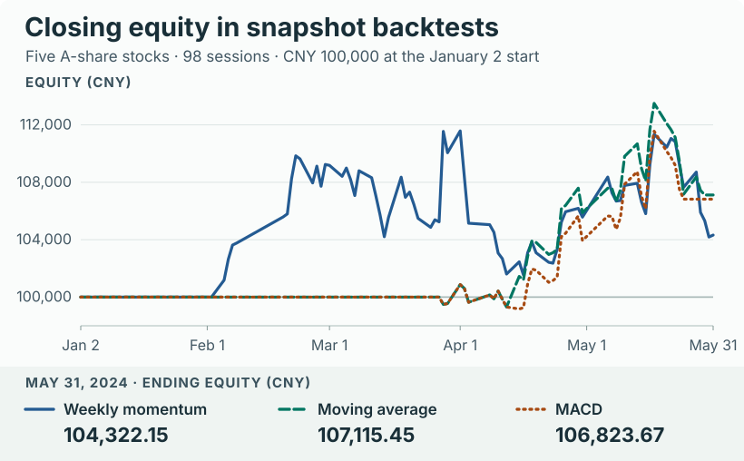
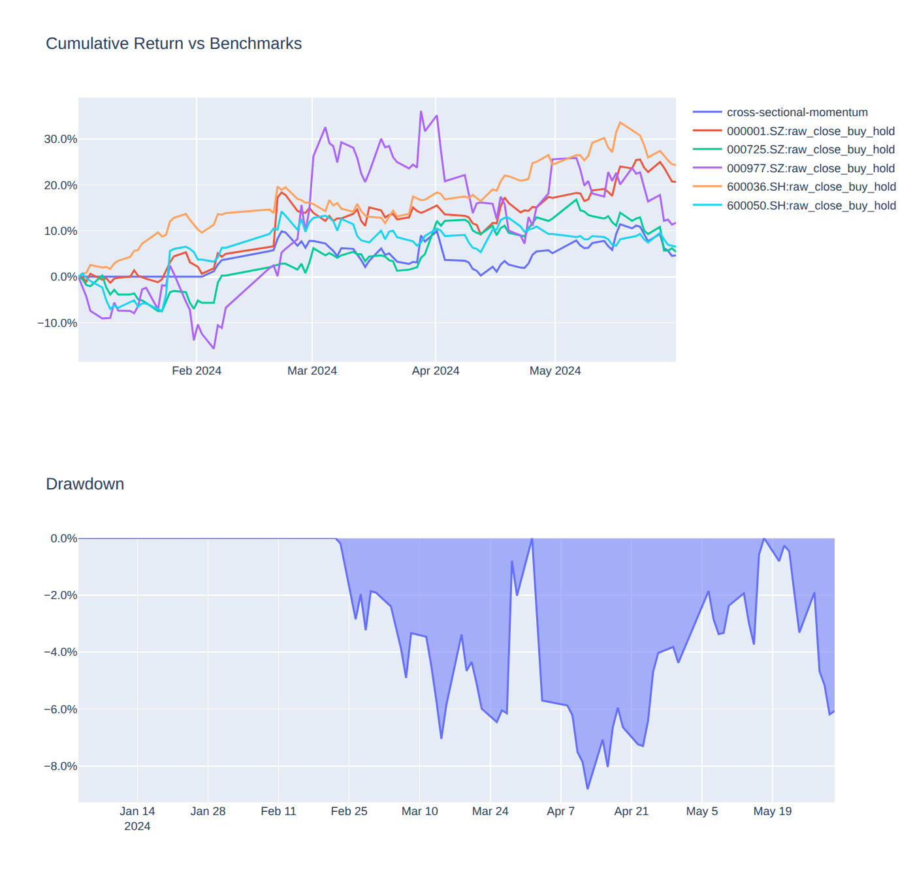
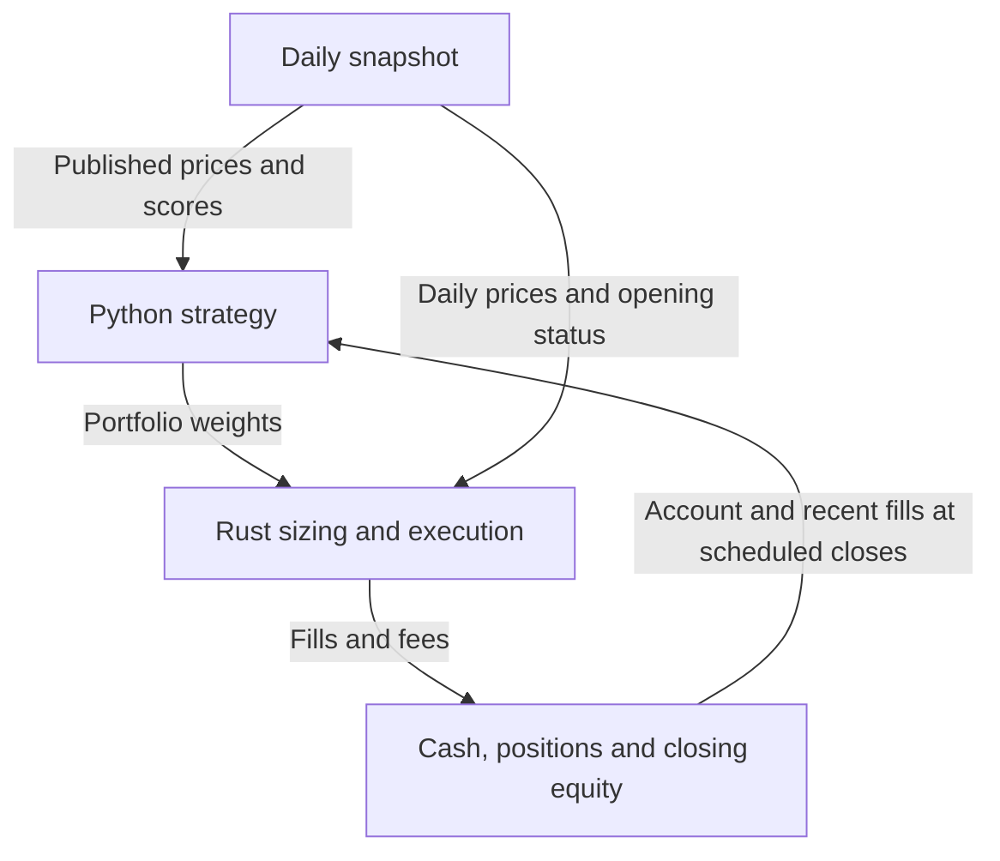

# TradeMaster

TradeMaster is a Python and Rust backtesting toolkit for Chinese A-shares and ETFs. At each scheduled close, a Python strategy sees its holdings and recent fills and chooses portfolio weights. Rust uses the same daily snapshot to calculate orders, simulate fills and track the account after fees. Interactive HTML reports show returns against a benchmark, drawdowns and trading costs. The research tools evaluate factors across the historical A-share universe.

**Data sources.** TuShare Pro is the only built-in historical data provider. Set `TUSHARE_TOKEN` to download its data once, then run the saved snapshot offline. To use data from another source, supply your own sessions, instruments, daily prices and optional features to `Snapshot.create`. [Snapshot inputs](docs/reference/snapshot-backtest.md#market-inputs-and-decision-timing)

[](https://www.python.org/) [](https://www.rust-lang.org/) [](LICENSE)

[Run the example](#run-the-example) · [Write a strategy](#write-a-strategy) · [Fifteen-year benchmark](#fifteen-year-benchmark) · [Backtest reports](#backtest-reports) · [Research a factor](#research-a-factor) · [Documentation](docs/README.md)

## Run the example

The account starts with 8,000 shares of A and CNY 20,000. On Friday the strategy picks B and keeps 20% of the account in cash. When A opens at its lower price limit on Monday, what can the account actually buy?

From the repository root, use Python 3.12 or later, [uv](https://docs.astral.sh/uv/) and Rust 1.97 or later. The script creates its own four-day market snapshot.

```bash
uv sync --locked
uv run python specs/examples/blocked_rotation.py
```

```text
Session     Cash (CNY)   Equity (CNY)
2024-01-05   20,000.00     100,000.00
2024-01-08   20,000.00      92,000.00
2024-01-09   91,995.00      91,995.00
2024-01-10   19,990.00      91,990.00
```

Monday's sell order is rejected. Tuesday's sale brings in CNY 71,995 after fees. At Wednesday's open, Rust buys 3,600 shares of B at CNY 20. The remaining CNY 19,990 includes the cash reserve and the amount left after rounding the order to whole lots. The script saves the orders, fills and daily account in `artifacts/blocked-rotation/result.json`. [Walk through the four sessions](docs/examples/rebalance-comparison.md#a-blocked-sale)

## Write a strategy

Define `on_close(day)` to choose portfolio weights after Rust has processed that session’s trades and valued the account. The MACD example trades China Merchants Bank (`600036.SH`). Each close updates the 12- and 26-session exponential moving averages. Their difference is the MACD line. When it crosses above its 9-session signal average, the strategy targets 100% in the stock. When it crosses below, the strategy targets cash.

```python
from decimal import Decimal

from trademaster.backtest import Snapshot, backtest
from trademaster.strategies.demo import MacdSpread


class MacdTiming:
    def __init__(self, symbol):
        self.symbol = symbol
        self.macd = MacdSpread(fast=12, slow=26, signal=9)
        self.previous = None

    def on_close(self, day):
        close = day.closes(self.symbol, adjusted=True, limit=1)[-1]
        current = self.macd.update(close)  # MACD line minus its signal average
        previous = self.previous
        self.previous = current

        if previous is None or current is None:
            return None
        if previous <= 0 < current:
            return {self.symbol: Decimal(1)}
        if previous >= 0 > current:
            return {self.symbol: Decimal(0)}
        return None
```

With the [TuShare example data](docs/examples/tushare-strategies.md#run-the-examples) prepared, run `uv run python -m trademaster.e2e.demo_strategies --engine snapshot` to create the five-stock snapshot. The same snapshot accepts the strategy defined above.

```python
market = Snapshot.open("artifacts/demo-snapshot/snapshot")
result = backtest(market, MacdTiming("600036.SH"), schedule="daily_close",
                  initial_cash=100_000, detail=True)
print(result.summary["fill_count"], result.equity[-1]["equity"])  # 5 106823.67
```

A strategy can also wait for a sale to fill before choosing its next holding. In the four-day example, A must be sold first. The strategy reads the actual share count at each close, then targets 80% in B once A is gone.

```python
class SwitchAfterSale:
    def __init__(self):
        self.sell_requested = False
        self.buy_requested = False

    def on_close(self, day):
        if day.account.quantity("A"):
            if not self.sell_requested:
                self.sell_requested = True
                return {}
        elif not self.buy_requested:
            self.buy_requested = True
            return {"B": Decimal("0.80")}
        return None
```

| What your strategy controls | Python API |
|---|---|
| When to decide | `schedule="daily_close"` calls the strategy after each trading session. `"week_end"` calls it after the last session of each trading week. |
| What to read | `day.closes(...)` provides price history. `day.scores(name)` returns published values across the listed instruments. `day.account` and `day.fills` show holdings, cash and fills through this close. |
| What to hold | Return long-only weights for the whole portfolio. Omitted holdings have zero target weight. `{}` targets cash. `None` leaves the existing instruction in effect. Rust can first trade the target at the next eligible open. |

For a precomputed strategy, pass dated weights to `backtest(..., targets=...)`. Existing strategies using `on_decision(day)` follow the same schedule. [MACD implementation](python/trademaster/strategies/demo.py) · [Account-aware example](specs/examples/blocked_rotation.py) · [Python API](docs/reference/snapshot-backtest.md)

The three-strategy example runs weekly momentum, moving-average timing and MACD on the same 98 TuShare sessions. [Strategy guide](docs/examples/tushare-strategies.md) · [Execution comparison and SDK timings](docs/examples/rebalance-comparison.md)



## Fifteen-year benchmark

A daily strategy reads the SSE 50 index (`000016.SH`) at the close and trades ChinaAMC SSE 50 ETF (`510050.SH`) at the next eligible open. It targets the ETF when the index is above its 200-close average and cash otherwise. The comparison buys and holds the same ETF. Both start with CNY 100,000, wait for 200 index closes and take cash distributions on the units they hold. The sample spans **3,644 trading sessions** from January 2011 through December 2025.

| Strategy | Closing equity (CNY) | Total return | Maximum drawdown | Simulated fills | Repeat run |
|---|---:|---:|---:|---:|---:|
| SSE 50 moving average | 202,977.32 | +102.98% | −33.36% | 113 | 51.8 ms |
| Buy and hold the ETF | 208,949.55 | +108.95% | −43.12% | 2 | 43.1 ms |


Cumulative profit and loss (P&L) is each day’s closing account value minus the initial CNY 100,000. It includes cash dividends and changes in the value of ETF units still held, after trading fees.

The first timing signal arrived at the close on Friday, February 24, 2012. On Monday the model bought 53,200 ETF units at the recorded open of CNY 1.847 and charged CNY 29.48. The model assumes small eligible orders fill in full at the opening price.

Times are medians of nine full runs per strategy on a Ryzen 7 8845H under WSL2. Each repeat starts a new account on the open snapshot. Set `TUSHARE_TOKEN` for the one-time download, then rerun the saved inputs offline.

```bash
uv run python -m trademaster.e2e.long_history prepare
uv run python -m trademaster.e2e.long_history run --check docs/examples/broad-etf-reference.json
```

[Data, dividends, costs and timing method](docs/examples/broad-etf.md) · [Strategy code](python/trademaster/e2e/long_history.py) · [Single-stock regression](docs/examples/long-history.md)

## Backtest reports

The event runner writes a standalone HTML report you can open offline. Zoom in on the return chart to compare the strategy with a benchmark, then inspect the drawdown over the same dates. The report also shows monthly returns, rolling volatility and Sharpe ratio, portfolio turnover and a breakdown of trading costs.



This report follows the weekly momentum strategy over 98 trading sessions. The return chart compares the strategy with buying and holding each of its five candidate stocks. The strategy finished up **4.67%**, with a maximum drawdown of **8.81%** and **CNY 696.06** in trading costs.

With the example data prepared, run the command below and open `artifacts/demo-strategies/cross-sectional-momentum/report.html` in a browser. [Prepare the TuShare example data](docs/examples/tushare-strategies.md#run-the-examples)

```bash
uv run python -m trademaster.e2e.demo_strategies --engine events
```

## Research a factor

Inspect the built-in factor definitions and the local catalog from the same environment.

```bash
uv run tm-factor list
uv run tm-factor describe fundamental.roe@1
uv run tm-factor library-sync
uv run tm-factor library-status
```

For a study across the A-share universe, set `TUSHARE_TOKEN` in your shell before creating a download plan. The planner reads the trading calendar and instrument list from Tushare Pro. Later runs reuse verified local data.

```bash
uv run tm-research-full-a --data-root data/research/demo plan \
  --start 2024-01-01 --end 2024-12-31 --statement-start 2023-01-01
```

Use the printed `plan_sha256` to fetch the first batch. Running the download command again resumes the same plan.

```bash
uv run tm-research-full-a --data-root data/research/demo download \
  --plan-sha256 "<plan_sha256>" --max-tasks 100
uv run tm-research-full-a --data-root data/research/demo status \
  --plan-sha256 "<plan_sha256>"
```

After the plan completes, use `materialize` to build the stock-by-day table and `evaluate` to compare factors by holding period. The research guide includes the full commands, forward-return definitions, and examples of rank correlation, turnover and trading capacity. [Full A-share research guide](docs/full-a-factor-research.md)

## How it works

A **data snapshot** records prices, trading permissions and the publication times of strategy inputs. A point-in-time query selects records published by the decision cutoff. If Friday's cutoff is the close, a statement released that evening first enters a later decision.



[Detailed daily execution diagram](specs/assets/code-architecture-refactor.svg) · [Replay the three-session event example](docs/reference/execution.md#replay-the-three-session-example)

| Question | Where to start |
|---|---|
| Which factors can I run, and what data do they need? | [Factor management](docs/factor-management.md) and [public factor library](docs/public-factor-library.md) |
| How do I run the industry rotation strategy? | [Industry strategy guide](python/trademaster/strategies/industry_fundamental/README.md) |
| Why was an order rejected? | Inspect the runner result. The [runtime guide](docs/architecture/overview.md) explains order checks, execution and settlement. |
| How can I reproduce a report? | The event bundle links source data, factor versions and trades to the report. A daily snapshot run saves a request and ledger result for [replay](docs/reference/snapshot-backtest.md#save-and-replay). |
| How does a target become a trade? | Follow a target from the Python decision to the Rust ledger in [Code Architecture Refactoring and Optimization](specs/20261104-code-architecture-refactor.md). |

The daily execution model accounts for lot sizes, suspensions, price limits, settlement delays, commission, tax and slippage. Factor reports measure price changes over a chosen period. Strategy reports use actual simulated fills, including delayed exits. The opening execution model fills an eligible small order at the observed open and applies the configured costs.

The industry strategy uses adjusted prices for trades and valuations. Its guide describes how it handles a missing daily bar, cash dividends and splits. [Industry strategy accounting](python/trademaster/strategies/industry_fundamental_top5/README.md)

## Development

Python research code lives in [python/trademaster](python/trademaster). Rust types and schemas live in [tm-core](crates/tm-core), execution and accounting in [tm-engine](crates/tm-engine), the Python extension in [tm-python](crates/tm-python), and saved-request decoding in [tm-runner](crates/tm-runner). Find individual files in the [repository and test map](docs/reference/repository.md) and command options in the [command reference](docs/reference/commands.md).

```bash
uv sync --locked --extra dev
uv run pytest -q
uv run ruff check python tests
uv run mypy --strict python
cargo fmt --all -- --check
cargo clippy --workspace --all-targets -- -D warnings
cargo test --workspace
uv build
```

The Python wheel includes the Rust engine and shared schemas. To replay a saved request, use `uv run tm-replay path/to/request.json`. Tests that require live Tushare access or a particular local data cache specify those requirements. [Contributor guide](AGENTS.md) · [Apache 2.0 license](LICENSE)
