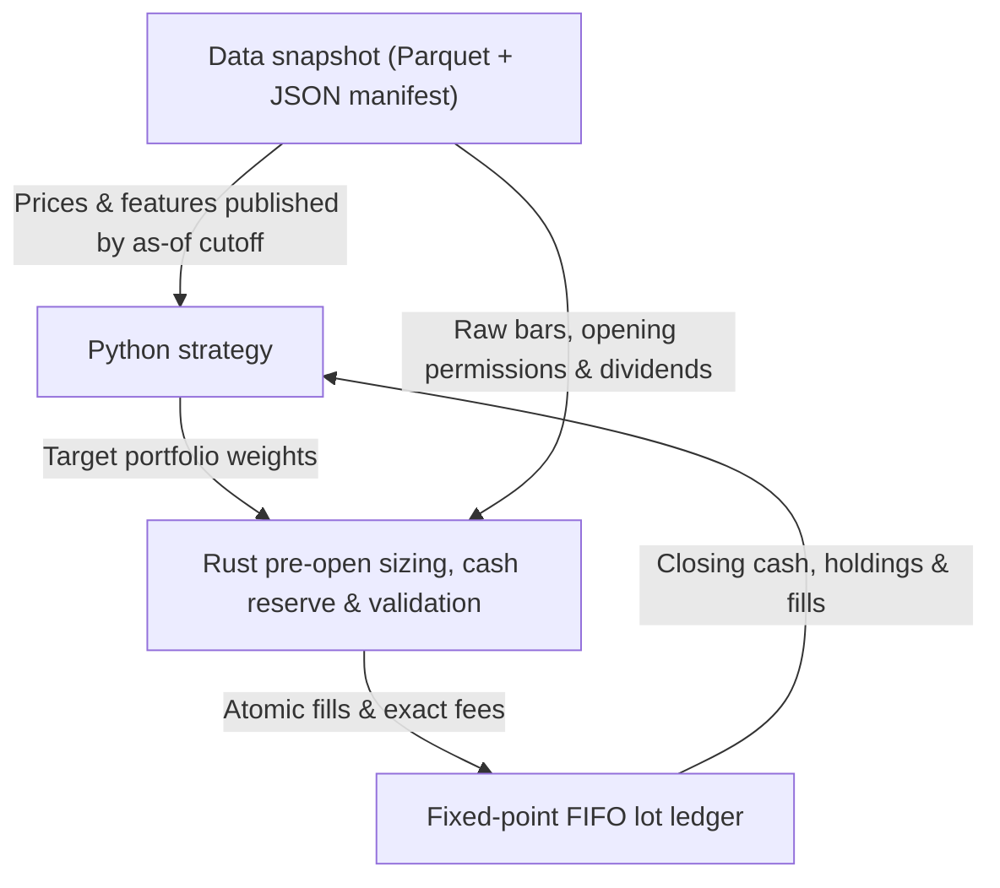

# TradeMaster

[](https://github.com/Obscurepawn/TradeMaster/actions/workflows/ci.yml) [](https://www.python.org/) [](https://www.rust-lang.org/) [](LICENSE)

**TradeMaster** is a reproducible quantitative research and portfolio backtesting framework that pairs a Python research and strategy SDK with an in-process, deterministic Rust execution and accounting engine. It ships with built-in Chinese A-share and ETF workflows backed by **Tushare Pro** (`TUSHARE_TOKEN`), configurable trading rules for US equities and other markets, and immutable market and fundamental ingestion via **[IndexOne](#download-indexone-data)** (`INDEXONE_API_KEY`).

[Quickstart](#run-the-example) · [Write a strategy](#write-a-strategy) · [A-share rules](#a-share-trading-rules) · [US equities](#backtest-a-us-stock-strategy) · [IndexOne data](#download-indexone-data) · [15-year benchmark](#fifteen-year-benchmark) · [Reports](#backtest-reports) · [Factor research](#research-a-factor) · [Architecture](#how-it-works) · [Documentation](docs/README.md) · [Contributing](CONTRIBUTING.md)

### Key Capabilities

- **Point-in-time data snapshots**: Bind market prices, directional opening permissions, corporate-action evidence, and feature publication timestamps into SHA-256-verified Parquet and JSON manifests indexed by DuckDB—preventing look-ahead bias and halting with `insufficient_data` when required trading evidence is missing.
- **Exact fixed-point Rust ledger**: Drive strategies in-process via PyO3 (`trademaster._native`) against a Rust `10^-8` fixed-point (`Fixed8`) FIFO lot ledger where cash, prices, portfolio weights, fees, and integer share quantities remain exact across every fill and valuation.
- **Configurable venue microstructure**: Model A-share rules out of the box—T+1 settlement, 100-share lots with odd-lot full-position exits, daily price limits, suspensions, price ticks, stamp duty, transfer fees, and record/ex/pay cash-dividend accounting—or configure T+0 settlement, whole-share lots, custom currencies, and fee schedules for US and global equities.
- **Deterministic replay and provenance**: Re-execute any saved snapshot request (`tm-replay`) for byte-consistent ledger verification, or emit v3 event bundles containing 11 schema-validated Parquet audit tables, account-state hash chains, and standalone offline Plotly HTML reports.
- **High-throughput simulation**: Complete a 15-year (3,644-session) daily strategy with dividend accounting in **~50 ms** once the data snapshot is open in memory.

### Execution Architecture at a Glance

TradeMaster provides two complementary execution paths backed by the same Rust lot-ledger primitives:

1. **Daily Snapshot SDK (`trademaster.backtest`)** — The primary interactive interface for target-weight portfolio strategies (`on_close(day)` callbacks or precomputed `targets=`). At each scheduled close, Python observes prices and features published by that session's cutoff alongside actual holdings and recent fills, then returns target weights eligible no earlier than the next open. Before checking the next session's opening prices, Rust first fixes final share quantities from prior closing marks and separately reserves the uninvested cash weight plus the capped buy cost and estimated fees, saving a JSON ledger and portable `tm-replay` request.
2. **Event Runner (`trademaster.e2e`)** — An event-driven pipeline that executes Arrow signals across explicit market, open, close, and settlement timestamps (sizing target weights at eligible opening marks where morning sale proceeds can fund same-open purchases), producing 11 validated Parquet audit tables, v3 provenance bundles, and offline HTML performance reports.

---

## Run the example

Suppose an account holds 8,000 shares of stock `A` and CNY 20,000 in cash on Friday. At Friday's close, a weekly rotation strategy targets 80% of equity in stock `B` while keeping 20% in cash—but `A` opens at its lower price limit on Monday morning, blocking the sale.

With Python 3.12+, [uv](https://docs.astral.sh/uv/), and Rust 1.97+ installed, run the self-contained four-session example from the repository root:

```bash
uv sync --locked
uv run python specs/examples/blocked_rotation.py
```

```text
Session     Cash (CNY)   Equity (CNY)
2024-01-05   20,000.00     100,000.00
2024-01-08   20,000.00      92,000.00
2024-01-09   91,995.00      91,995.00
2024-01-10   19,990.00      91,990.00
```

Because `A` opens at its lower limit on Monday (`2024-01-08`), the sell order is rejected and the available CNY 20,000 cash cannot exceed the strategy's 20% cash reserve to buy `B`. Once `A` trades freely at Tuesday's open (`2024-01-09`), the sale brings cash to CNY 91,995 after the CNY 5 minimum commission, funding Wednesday morning's purchase of 3,600 shares of `B` at CNY 20 and leaving CNY 19,990 in cash (the target reserve plus whole-lot rounding remainder after fees). Orders, fills, and daily balances are written to `artifacts/blocked-rotation/result.json` ([session-by-session walkthrough](docs/examples/rebalance-comparison.md#a-blocked-sale)).

## Write a strategy

Snapshot strategies implement `on_close(day)`, which Rust invokes after settling the session's trades and valuing the closing account. The callback inspects prices, point-in-time features, and current holdings, then returns long-only portfolio weights that become eligible to trade at the next open.

### Single-stock timing with MACD

The strategy below trades China Merchants Bank (`600036.SH`) on daily adjusted closes, targeting 100% equity when the 12/26-session MACD line crosses above its 9-session signal average, exiting to cash when it crosses below, and keeping the existing instruction (`None`) otherwise:

```python
from decimal import Decimal

from trademaster.backtest import Snapshot, backtest
from trademaster.strategies.demo import MacdSpread


class MacdTiming:
    def __init__(self, symbol):
        self.symbol = symbol
        self.macd = MacdSpread(fast=12, slow=26, signal=9)
        self.previous = None

    def on_close(self, day):
        close = day.closes(self.symbol, adjusted=True, limit=1)[-1]
        current = self.macd.update(close)  # MACD line minus its signal average
        previous = self.previous
        self.previous = current

        if previous is None or current is None:
            return None
        if previous <= 0 < current:
            return {self.symbol: Decimal(1)}
        if previous >= 0 > current:
            return {self.symbol: Decimal(0)}
        return None
```

After preparing the five-stock Tushare demo snapshot via its `--engine snapshot` workflow ([setup guide](docs/examples/tushare-strategies.md#run-the-examples)), run the strategy directly against the saved snapshot:

```python
market = Snapshot.open("artifacts/demo-snapshot/snapshot")
result = backtest(market, MacdTiming("600036.SH"), schedule="daily_close",
                  initial_cash=100_000, detail=True)
print(result.summary["fill_count"], result.equity[-1]["equity"])  # 5 106823.67
```

### Weekly stock selection across the A-share market

At each week's final trading close, this cross-sectional strategy ranks all A-shares listed on that session by their 20-session adjusted-close return, breaking ties by stock code and skipping names with missing endpoint prices. It allocates 10% to each of up to ten top-ranked stocks and leaves any unfilled slots in cash:

```python
from decimal import Decimal
from math import isfinite


class AllAMomentum:
    def on_close(self, day):
        ranking = []
        for symbol in day.instruments:
            closes = day.closes(symbol, adjusted=True, limit=21)
            if len(closes) < 21 or closes[0] is None or closes[-1] is None:
                continue
            momentum = closes[-1] / closes[0] - 1
            if isfinite(momentum):
                ranking.append((-momentum, symbol))  # Higher returns sort first.

        winners = sorted(ranking)[:10]
        return {symbol: Decimal("0.10") for _, symbol in winners}
```

With a local [Tushare research panel](docs/examples/all-a-momentum.md) covering Shanghai, Shenzhen, and Beijing listings, publish the snapshot (whose initial 20 sessions provide warm-up history) and execute the weekly run:

```bash
uv run python specs/examples/prepare_all_a_snapshot.py
uv run python specs/examples/all_a_momentum.py artifacts/all-a-momentum/snapshot --output artifacts/all-a-momentum/run
```

At the July 31, 2026 close, 5,506 of 5,534 listed A-shares had complete 20-session endpoints; the strategy selected ten names whose orders first became eligible on August 3, generating 49 fills across the 30-session window ([source](specs/examples/all_a_momentum.py) · [walkthrough and order breakdown](docs/examples/all-a-momentum.md)).

| Concern | Snapshot SDK contract |
|---|---|
| **Decision schedule** | `schedule="daily_close"` invokes `on_close` after every session; `"week_end"` invokes it on the final trading session of each week. Precomputed dated weights can be passed directly via `backtest(..., targets=...)`. |
| **Observable state** | `day.closes(...)` reads historical closes through the session cutoff; `day.scores(name)` reads features published by that cutoff; `day.account` and `day.fills` expose current cash, holdings (`quantity`, `sellable_quantity`), dividend receivables, and recent fills. |
| **Target semantics** | Return nonnegative `Decimal` weights (up to `10^-8` precision, summing to `<= 1`) for the entire portfolio. Omitted holdings target zero; `{}` exits to cash; `None` retains the active instruction. Orders execute no earlier than the next eligible open. |

See the [MACD implementation](python/trademaster/strategies/demo.py), [account-aware rotation](specs/examples/blocked_rotation.py), [daily snapshot API reference](docs/reference/snapshot-backtest.md), and the three-strategy comparison across 98 Tushare sessions ([strategy guide](docs/examples/tushare-strategies.md) · [engine comparison and SDK timings](docs/examples/rebalance-comparison.md)):


## A-share trading rules

In a daily snapshot backtest, Rust validates every planned order against that session's directional opening evidence, fills eligible orders at the recorded opening price, and updates the closing account visible to Python.

| Rule | Simulation behavior |
|---|---|
| **Daily price limits** | Uses each stock's recorded session limits when enforcement is enabled: an open at the upper limit blocks buys and an open at the lower limit blocks sells, while the opposite side remains tradable. |
| **Trading suspensions** | A confirmed full-day suspension blocks both sides; held shares remain in the portfolio valued at their prior mark, adjusted for any cash dividend going ex that session. |
| **Lot rounding & odd lots** | Defaults to **100-share lots** for A-shares. Buys and partial sells round down to whole multiples of 100, whereas a full-position exit sells any trailing odd lot (e.g., all 1,050 sellable shares). |
| **T+1 settlement** | Shares purchased under T+1 unlock for sale on the next trading session (`settlement="t0"` enables same-session resale eligibility where appropriate). |
| **Price ticks & caps** | Rounds each buy-price cap down to the instrument's tick size before cash reservation and opening-price checks. |
| **Pre-open cash budget** | Fixes share quantities from prior marks first, then sets aside the target cash weight plus capped buy costs and estimated fees from already-settled cash; filled sales fund buys starting at the next open. |
| **Commissions & duties** | Applies commission subject to a per-fill minimum, stamp duty on sells, and Shanghai transfer fees; rejected orders incur zero cost. |
| **Cash dividends** | Record-date closing holdings determine entitlement; on the ex-date the distribution enters equity as a receivable and adjusts the prior mark for sizing, then credits spendable cash at the pay-date close. |

In the 30-session all-A momentum run above, 49 of 63 planned orders filled while five were blocked by suspensions, one by an upper-limit open, and eight by opening above the strategy's buy cap ([order details](docs/examples/all-a-momentum.md#from-selection-to-fills)). Because STAR Market and Beijing Exchange listings follow different lot-sizing rules, the full-A loader marks their opening permissions as `"unknown"`; if a strategy attempts to trade an instrument with unknown opening evidence, the engine halts with `insufficient_data` before posting fills for that open ([snapshot API](docs/reference/snapshot-backtest.md) · [ledger tests](crates/tm-engine/tests/snapshot_backtest.rs)).

To model another market, configure instrument lot sizes, ticks, settlement, currency, and `Policy` fee parameters explicitly as documented in [Configurable trading rules](docs/reference/snapshot-backtest.md#configurable-trading-rules).

## Backtest a US stock strategy

The same daily snapshot SDK supports whole-share, T+0 USD portfolios. The [synthetic US equity example](specs/examples/us_stock_backtest.py) builds a five-session `DEMO.US` **data snapshot** with 16:00 `America/New_York` close cutoffs and runs a strategy targeting 80% equity after a rising close and 100% cash after a flat or falling close (using zero fees and slippage purely as transparent demonstration settings, not a brokerage schedule):

```bash
uv sync --locked
uv run python specs/examples/us_stock_backtest.py
uv run tm-replay artifacts/us-stock-demo/run/request.json
```

```text
2024-01-04 buy 76 @ 102.00 USD
2024-01-05 sell 76 @ 101.00 USD
Final equity: 9924.00 USD
```

At the January 3 close (16:00 New York time), the strategy observes the price rising from 100 to 102 and submits an 80% target eligible at January 4's open. Before reading January 4's opening price, Rust first sets the order quantity from the prior close—scaling the initial 78-share target down to a final **76 shares** so the order fits within the USD 8,000 investable budget under the 2% buy cap—and separately sets aside USD 2,000 for the uninvested cash reserve plus USD 7,907.04 for the capped purchase. The order fills at the USD 102.00 open for USD 7,752.00, and January 4's lower close (`101`) triggers a full exit at January 5's open. `tm-replay` re-executes `artifacts/us-stock-demo/run/request.json` and emits JSON identical to `result.json`.

### Use an existing US data snapshot

To backtest on historical US equities, acquire bars via [IndexOne](#download-indexone-data) or your preferred vendor and publish a snapshot following the [US data preparation guide](.skills/trademaster-backtest/references/data-sources.md#prepare-a-us-stock-data-snapshot)—preserving missing opening-status evidence as `"unknown"` and reviewing [configurable trading rules](docs/reference/snapshot-backtest.md#configurable-trading-rules) and [cash-dividend constraints](docs/reference/snapshot-backtest.md#cash-dividends) for unsupported corporate actions.

The self-contained snippet below opens the saved snapshot from the example above (replace `snapshot_path`, `symbol`, and the zero-cost `Policy` fields for your own study) and verifies deterministic replay:

```bash
uv run python - <<'PY'
from decimal import Decimal
from trademaster.backtest import BacktestDay, Policy, Snapshot, backtest


class CloseMomentum:
    def __init__(self, symbol: str) -> None:
        self.symbol = symbol

    def on_close(self, day: BacktestDay) -> dict[str, Decimal] | None:
        prices = day.closes(self.symbol, adjusted=True, limit=2)
        if len(prices) < 2 or prices[0] is None or prices[1] is None:
            return None
        return {self.symbol: Decimal("0.80")} if prices[1] > prices[0] else {}


snapshot_path = "artifacts/us-stock-demo/snapshot"
symbol = "DEMO.US"
market = Snapshot.open(snapshot_path)
policy = Policy(
    enforce_price_limits=False,
    sell_stamp_duty_ppm=0,
    sse_transfer_fee_ppm=0,
    commission_ppm=0,
    minimum_commission=0,
    slippage_ppm=0,
    buy_cap_ppm=20_000,
)
result = backtest(
    market,
    CloseMomentum(symbol),
    initial_cash=10_000,
    policy=policy,
    detail=True,
)
result.save("artifacts/us-stock-rerun")
print(f"{result.summary['status']}: {len(result.fills)} fills, "
      f"{result.equity[-1]['equity']:.2f} USD")
PY
uv run tm-replay artifacts/us-stock-rerun/request.json
```

Pass `schedule="week_end"` for weekly rebalancing or [`targets=`](docs/reference/snapshot-backtest.md#targets-and-the-daily-account) for precomputed dated portfolios. Snapshot runs persist JSON artifacts; see [Backtest reports](#backtest-reports) for the event runner's HTML output.

## Download IndexOne data

With `INDEXONE_API_KEY` set in your shell environment, `IndexOneDataSource` downloads daily prices, company financials, security reference records, and FX rates into immutable local Parquet files paired with cryptographic request evidence. Subsequent identical queries reuse the verified local cache offline:

```bash
uv sync --locked
uv run python - <<'PY'
from pathlib import Path
from trademaster.data import IndexOneDataSource

with IndexOneDataSource(root=Path("data/indexone")) as source:
    prices = source.query_with_evidence(
        "eod",
        params={"filters": [
            {"field": "id", "operator": "eq", "value": "BBG000B9XRY4"},
            {"field": "date", "operator": "gte", "value": "2024-01-02"},
            {"field": "date", "operator": "lte", "value": "2024-01-05"},
        ]},
        fields=("id", "date", "open", "close", "volume", "adjClose"),
        page_limit=10000,
    )
    print(f"{prices.table.num_rows} rows")
    print(prices.evidence.path)
PY
```

Consult the [IndexOne reference](docs/reference/indexone.md) for the `tm-indexone` CLI, financial statement schemas, offline/refresh flags, and the exchange-calendar, trading-permission, and publication-timestamp checks required before building a backtest data snapshot from raw observations.

## Fifteen-year benchmark

This benchmark evaluates a daily trend-following strategy that observes the SSE 50 index (`000016.SH`) at each 15:00 Shanghai close and trades ChinaAMC SSE 50 ETF (`510050.SH`) at the next eligible open—holding the ETF when the index closes above its 200-session moving average and cash otherwise—against a buy-and-hold control over **3,644 trading sessions** (January 2011 – December 2025). Both accounts start with CNY 100,000, wait through the 200-session warm-up (entering their first eligible trade on Monday, February 27, 2012 after Friday's close signal), assume eligible orders fill at the recorded open, and accrue cash distributions across record, ex, and pay dates.

| Strategy | Closing equity (CNY) | Total return | Maximum drawdown | Simulated fills | Median runtime |
|---|---:|---:|---:|---:|---:|
| SSE 50 200-day moving average | 202,977.32 | +102.98% | −33.36% | 113 | 51.8 ms |
| Buy and hold `510050.SH` | 208,949.55 | +108.95% | −43.12% | 2 | 43.1 ms |


Cumulative P&L measures daily closing account value (cash, ETF holdings, and outstanding dividend receivables net of trading fees) minus the initial CNY 100,000. Runtimes are medians of nine full runs per strategy on an AMD Ryzen 7 8845H under WSL2, each initializing a fresh ledger over the open in-memory snapshot. Set `TUSHARE_TOKEN` once to prepare the local snapshot, then run and verify offline against the checked-in reference:

```bash
uv run python -m trademaster.e2e.long_history prepare
uv run python -m trademaster.e2e.long_history run --check docs/examples/broad-etf-reference.json
```

See [ETF data, distributions, and timing methodology](docs/examples/broad-etf.md), [benchmark implementation](python/trademaster/e2e/long_history.py), and the [single-stock long-history regression](docs/examples/long-history.md).

## Backtest reports

The event runner (`trademaster.e2e`) packages standalone, offline-ready Plotly HTML reports alongside its v3 provenance bundle, featuring interactive cumulative-return and benchmark comparisons, underwater drawdowns, monthly return heatmaps, rolling volatility and Sharpe diagnostics, portfolio turnover, and fee breakdowns.


In the 98-session weekly cross-sectional momentum run shown above, the portfolio returned **+4.67%** against its five-stock universe with an **8.81%** maximum drawdown and **CNY 696.06** in total trading costs. Run the five-stock guide's `--engine events` command against your local Tushare cache and open `artifacts/demo-strategies/cross-sectional-momentum/report.html` in any browser ([report generation walkthrough](docs/examples/tushare-strategies.md#run-the-examples)).

## Research a factor

Inspect built-in managed factor definitions (`ID@VERSION`) and synchronize the public factor candidate catalog directly from the CLI:

```bash
uv run tm-factor list
uv run tm-factor describe fundamental.roe@1
uv run tm-factor library-sync
uv run tm-factor library-status
```

For full-universe A-share studies, export `TUSHARE_TOKEN` to plan and incrementally download historical prices, trading status, and financial statements into verified local Parquet storage; interrupted downloads resume cleanly from the same `plan_sha256`:

```bash
uv run tm-research-full-a --data-root data/research/demo plan \
  --start 2024-01-01 --end 2024-12-31 --statement-start 2023-01-01

uv run tm-research-full-a --data-root data/research/demo download \
  --plan-sha256 "<plan_sha256>" --max-tasks 100
uv run tm-research-full-a --data-root data/research/demo status \
  --plan-sha256 "<plan_sha256>"
```

Once acquisition finishes, run `materialize` to assemble the survivorship-free stock-by-session panel and `evaluate` to score factors using non-compounded quantile returns, IC / Rank IC, long-short spreads, turnover, and capacity diagnostics ([Full A-share factor research guide](docs/full-a-factor-research.md)).

## How it works

Every backtest consumes a **data snapshot** that binds prices, venue trading permissions, and input publication timestamps to a verifiable manifest. Point-in-time queries filter observations by each session's `as-of` decision cutoff (defaulting to 15:00 `Asia/Shanghai` for A-shares): if Friday's cutoff is the 15:00 close, an earnings release published Friday evening first becomes visible at the next scheduled decision, and any order derived from Friday's close can execute no earlier than Monday's open.



[Architecture overview](docs/architecture/overview.md) · [Daily execution diagram](specs/assets/code-architecture-refactor.svg) · [Replay the three-session event example](docs/reference/execution.md#replay-the-three-session-example)

| Question | Reference |
|---|---|
| Which factors are built in, and what data do they require? | [Managed factor guide](docs/factor-management.md) and [public factor library](docs/public-factor-library.md) |
| How does a target weight become an executed trade? | [Daily portfolio snapshot API](docs/reference/snapshot-backtest.md) and [Architecture overview](docs/architecture/overview.md) |
| Why was an order rejected or a run halted? | Inspect `result.orders` or `result.raw["first_issue"]`; see [Architecture overview](docs/architecture/overview.md) and [Missing prices and opening evidence](docs/reference/snapshot-backtest.md#missing-prices-and-opening-evidence) |
| How do I reproduce a saved run or HTML report? | Re-execute snapshot or event JSON via [`tm-replay`](docs/reference/snapshot-backtest.md#save-and-replay), or verify v3 event bundles via `verify_e2e_bundle` |
| How do the industry-rotation strategies handle historical data? | [Industry strategy guide](python/trademaster/strategies/industry_fundamental/README.md) and [adjusted-price accounting limits](python/trademaster/strategies/industry_fundamental_top5/README.md) |

Factor evaluations measure cross-sectional quantile returns over fixed forward horizons, whereas strategy backtests measure realized account equity from the Rust engine's simulated fills, delayed exits, dividend entitlements, and transaction costs.

## Development

Python research, factor, data, and SDK packages live under [`python/trademaster`](python/trademaster), paired with four Rust crates: [`tm-core`](crates/tm-core) (fixed-point domain primitives and schemas), [`tm-engine`](crates/tm-engine) (order sizing, market rules, and FIFO lot ledger), [`tm-runner`](crates/tm-runner) (saved-request decoding and replay), and [`tm-python`](crates/tm-python) (PyO3 native bindings). Browse file locations in the [repository map](docs/reference/repository.md) and CLI flags in the [command reference](docs/reference/commands.md).

```bash
uv sync --locked --extra dev
uv run ruff check python tests
uv run mypy --strict python tests
uv run pytest -q
cargo fmt --all -- --check
cargo clippy --locked --workspace --all-targets -- -D warnings
cargo test --locked --workspace
uv build
```

### Coding agent integration

TradeMaster includes structured repository rules in [`AGENTS.md`](AGENTS.md) and a dedicated [TradeMaster backtesting skill](.skills/trademaster-backtest/SKILL.md) covering strategy implementation, snapshot preparation for A-shares, ETFs, and US equities, deterministic `tm-replay` checks, and HTML report verification. Point your coding agent to `.skills/trademaster-backtest/SKILL.md` (or symlink it into `.agents/skills/trademaster-backtest`) to automate end-to-end research and backtest workflows.

---

[Contributing guide](CONTRIBUTING.md) · [Documentation](docs/README.md) · [Apache 2.0 License](LICENSE)
