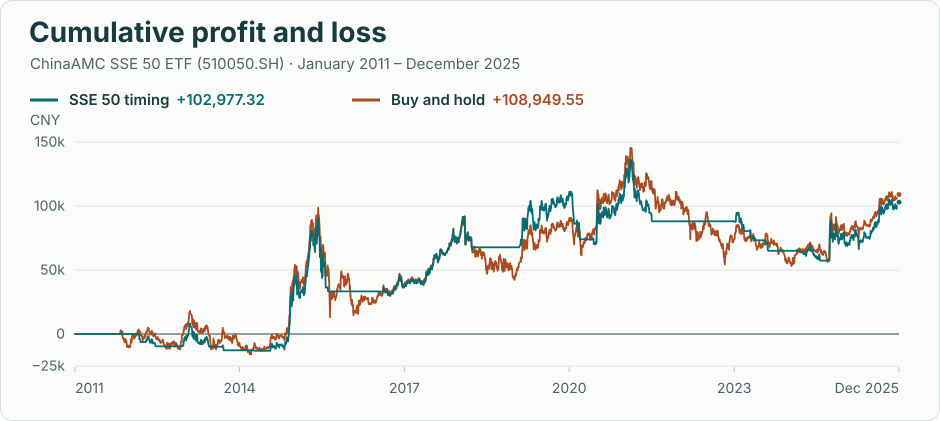
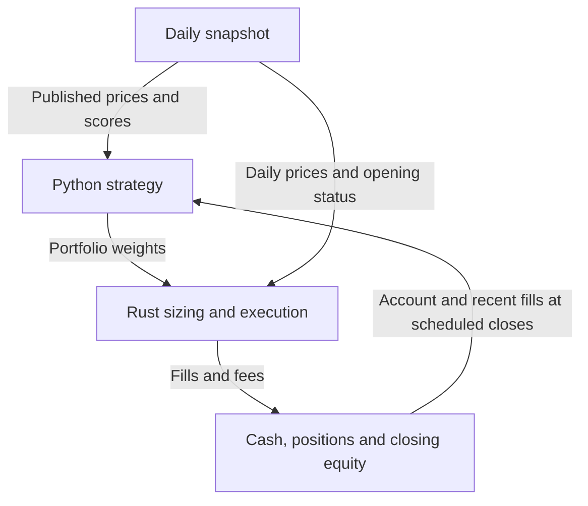

# TradeMaster

TradeMaster backtests Python portfolio strategies with a Rust engine and provides factor research tools for A-shares. A strategy chooses weights at scheduled closes; the engine calculates orders, simulates fills and tracks the account after fees.

**Data sources.** TuShare Pro supplies the built-in A-share and ETF workflows through `TUSHARE_TOKEN`. [IndexOne](#download-indexone-data) supplies daily prices, company financials, security reference data and FX through `INDEXONE_API_KEY`. Both retain downloaded data for offline reuse. To prepare a backtest, map the source observations and trading evidence into a [data snapshot](docs/reference/snapshot-backtest.md#market-inputs-and-decision-timing).

[](https://www.python.org/) [](https://www.rust-lang.org/) [](LICENSE)

[Run the example](#run-the-example) · [A-share trading rules](#a-share-trading-rules) · [US stock backtests](#backtest-a-us-stock-strategy) · [IndexOne data](#download-indexone-data) · [Write a strategy](#write-a-strategy) · [Fifteen-year benchmark](#fifteen-year-benchmark) · [Backtest reports](#backtest-reports) · [Research a factor](#research-a-factor) · [Use a coding agent](#use-a-coding-agent) · [Documentation](docs/README.md)

## Run the example

The account starts with 8,000 shares of A and CNY 20,000. On Friday the strategy picks B and keeps 20% of the account in cash. When A opens at its lower price limit on Monday, what can the account actually buy?

From the repository root, use Python 3.12 or later, [uv](https://docs.astral.sh/uv/) and Rust 1.97 or later. The script creates its own four-day market snapshot.

```bash
uv sync --locked
uv run python specs/examples/blocked_rotation.py
```

```text
Session     Cash (CNY)   Equity (CNY)
2024-01-05   20,000.00     100,000.00
2024-01-08   20,000.00      92,000.00
2024-01-09   91,995.00      91,995.00
2024-01-10   19,990.00      91,990.00
```

Monday's sell order is rejected. Tuesday's sale brings in CNY 71,995 after fees. At Wednesday's open, Rust buys 3,600 shares of B at CNY 20. The remaining CNY 19,990 includes the cash reserve and the amount left after rounding the order to whole lots. The script saves the orders, fills and daily account in `artifacts/blocked-rotation/result.json`. [Walk through the four sessions](docs/examples/rebalance-comparison.md#a-blocked-sale)

## A-share trading rules

The daily backtest checks each planned order against the stock’s trading status at the open. It assumes eligible small orders fill at the recorded opening price. The strategy sees the resulting holdings and cash at the close.

| Case | What happens in the backtest |
|---|---|
| Price limits | The TuShare stock example uses each stock’s recorded limits for that session. An open at the upper limit blocks buys. An open at the lower limit blocks sells. The opposite side can still trade. |
| Trading suspensions | A confirmed full-day suspension blocks both sides. The account keeps the shares and carries their last valuation, adjusted for any recorded cash dividend going ex that day. |
| Minimum buy and lot size | The default A-share lot is **100 shares**. The smallest buy order is one lot, and larger buys must be multiples of 100. Partial sales also use whole lots. When selling an entire position of 1,050 sellable shares, the order includes the final 50. |
| T+1 settlement | Stocks bought under T+1 become sellable on the next trading session. |
| Price ticks | The engine rounds each buy-price cap down to the instrument’s price tick. |
| Cash when rotating stocks | The model sets the buy budget before the open and reserves the target cash weight and estimated fees. A blocked sale leaves the shares in the account. A filled sale can fund buys from the next open. |
| Trading costs | Each fill incurs the configured commission, subject to a minimum. The stock fee schedule adds stamp duty on sells and a transfer fee on Shanghai stock trades. Rejected orders incur no fees. |
| Cash dividends | Holdings at the record-date close determine entitlement. On the ex-date the dividend appears in equity as a receivable. At the payment-date close it moves into cash, ready for the next open. |

In the 30-session TuShare example, 49 of 63 orders filled. Suspensions blocked five orders. One buy was rejected because the stock opened at its upper limit. Eight other buys were rejected because the opening price exceeded the strategy’s own cap. [Orders and results](docs/examples/all-a-momentum.md#from-selection-to-fills)

The full-A example ranks Shanghai, Shenzhen and Beijing listings. It marks opening permissions as unknown for STAR Market and Beijing stocks, whose order sizes follow different rules. If a planned order needs unknown opening data, the run reports `insufficient_data` before posting any fills for that open. [Snapshot API](docs/reference/snapshot-backtest.md) · [Execution and ledger tests](crates/tm-engine/tests/snapshot_backtest.rs)

For another market, configure the instrument's trading units and the run's
costs explicitly. The [rule reference](docs/reference/snapshot-backtest.md#configurable-trading-rules)
explains the settings and includes a price-limit switch comparison.

## Backtest a US stock strategy

Use the daily snapshot SDK for a long-only, whole-share USD portfolio. The
[US stock example](specs/examples/us_stock_backtest.py) creates five synthetic
sessions and runs a strategy that targets 80% after a rising close and cash after
a flat or falling close. It uses zero fees and slippage to make the account easy
to check; these are example assumptions, not a broker's fee schedule.

From the repository root:

```bash
uv sync --locked
uv run python specs/examples/us_stock_backtest.py
uv run tm-replay artifacts/us-stock-demo/run/request.json
```

The strategy command prints:

```text
2024-01-04 buy 76 @ 102.00 USD
2024-01-05 sell 76 @ 101.00 USD
Final equity: 9924.00 USD
```

At the January 3 close the strategy sees 102 after 100 and requests an 80% weight.
The first eligible fill is January 4's open. Before checking that open, Rust
calculates a 78-share target from the prior close and fixes the buy order at 76
shares within the USD 8,000 budget and 2% buy cap. It then reserves USD 7,907.04;
the fill costs USD 7,752. January 4's falling close requests an exit at January 5's
open. The example saves a data snapshot under `artifacts/us-stock-demo/snapshot`
and the request and result under `artifacts/us-stock-demo/run`. Replay prints the
recalculated ledger as JSON; compare it with `result.json`.

### Use an existing US data snapshot

For historical US data, download observations with [IndexOne](#download-indexone-data)
or use another source, then prepare a data snapshot with your own loader.
The [data preparation guide](.skills/trademaster-backtest/references/data-sources.md#prepare-a-us-stock-data-snapshot)
covers USD instruments, exchange sessions, New York close times and source
records. When trading status is missing, the loader must explicitly set the
affected buy/sell permission to `"unknown"`.

The following command opens the snapshot from the example above and runs the
same strategy again. To use your history, replace `snapshot_path` and `symbol`
with the directory and instrument ID produced by your loader. The example
strategy needs adjusted closes. Set the commission and slippage for your study;
the zeros below retain the demonstration's assumptions.

```bash
uv run python - <<'PY'
from specs.examples.us_stock_backtest import CloseMomentum
from trademaster.backtest import Policy, Snapshot, backtest

snapshot_path = "artifacts/us-stock-demo/snapshot"
symbol = "DEMO.US"
market = Snapshot.open(snapshot_path)
policy = Policy(
    enforce_price_limits=False,
    sell_stamp_duty_ppm=0,
    sse_transfer_fee_ppm=0,
    commission_ppm=0,
    minimum_commission=0,
    slippage_ppm=0,
    buy_cap_ppm=20_000,
)
result = backtest(
    market,
    CloseMomentum(symbol),
    initial_cash=10_000,
    policy=policy,
    detail=True,
)
result.save("artifacts/us-stock-rerun")
print(f"{result.summary['status']}: {len(result.fills)} fills, "
      f"{result.equity[-1]['equity']:.2f} USD")
PY
uv run tm-replay artifacts/us-stock-rerun/request.json
```

Replace `CloseMomentum` with your own `on_close(day)` strategy. Add
`schedule="week_end"` to `backtest` for weekly callbacks. Dated target portfolios
use the separate [`targets=` input](docs/reference/snapshot-backtest.md#targets-and-the-daily-account).
Snapshot runs save JSON; see [Backtest reports](#backtest-reports) for the event
workflow's HTML output.

Before using historical data, check the [execution scope](docs/reference/snapshot-backtest.md#configurable-trading-rules)
and [cash-dividend requirements](docs/reference/snapshot-backtest.md#cash-dividends),
including unsupported corporate actions and broker account rules.

## Download IndexOne data

Set `INDEXONE_API_KEY` in your shell to the secret value of an IndexOne team key.
From the repository root, this query downloads Apple's daily observations into
Parquet and prints the returned row count and evidence path. Repeating it reads
the same local cache.

```bash
uv sync --locked
uv run python - <<'PY'
from pathlib import Path
from trademaster.data import IndexOneDataSource

with IndexOneDataSource(root=Path("data/indexone")) as source:
    prices = source.query_with_evidence(
        "eod",
        params={"filters": [
            {"field": "id", "operator": "eq", "value": "BBG000B9XRY4"},
            {"field": "date", "operator": "gte", "value": "2024-01-02"},
            {"field": "date", "operator": "lte", "value": "2024-01-05"},
        ]},
        fields=("id", "date", "open", "close", "volume", "adjClose"),
        page_limit=10000,
    )
    print(f"{prices.table.num_rows} rows")
    print(prices.evidence.path)
PY
```

The [IndexOne guide](docs/reference/indexone.md) covers financial statements,
security identifiers, the `tm-indexone` command, offline reads and refreshes.
These are source observations: a US backtest still needs exchange sessions,
opening permissions and corporate-action coverage. The guide explains the
publication-time checks needed before using financial data in a strategy.

## Write a strategy

Both strategies implement `on_close(day)`. Rust calls it after processing the session’s trades and valuing the account. Python returns the weights it wants to hold, and Rust can first trade that portfolio at the next eligible open.

### Single-stock timing with MACD

Trade China Merchants Bank (`600036.SH`) using its daily adjusted close. The MACD line is the 12-session exponential moving average minus the 26-session average. Cross above its 9-session signal average and the strategy targets 100% in the stock. Cross below and it targets cash. Between crossings it keeps its current instruction.

```python
from decimal import Decimal

from trademaster.backtest import Snapshot, backtest
from trademaster.strategies.demo import MacdSpread


class MacdTiming:
    def __init__(self, symbol):
        self.symbol = symbol
        self.macd = MacdSpread(fast=12, slow=26, signal=9)
        self.previous = None

    def on_close(self, day):
        close = day.closes(self.symbol, adjusted=True, limit=1)[-1]
        current = self.macd.update(close)  # MACD line minus its signal average
        previous = self.previous
        self.previous = current

        if previous is None or current is None:
            return None
        if previous <= 0 < current:
            return {self.symbol: Decimal(1)}
        if previous >= 0 > current:
            return {self.symbol: Decimal(0)}
        return None
```

Follow the five-stock guide through its `--engine snapshot` command. It uses the same data directory and plan ID as the download and writes the snapshot used below. [Prepare the TuShare example](docs/examples/tushare-strategies.md#run-the-examples)

```python
market = Snapshot.open("artifacts/demo-snapshot/snapshot")
result = backtest(market, MacdTiming("600036.SH"), schedule="daily_close",
                  initial_cash=100_000, detail=True)
print(result.summary["fill_count"], result.equity[-1]["equity"])  # 5 106823.67
```

### Weekly stock selection across the A-share market

At the last close of each trading week, rank the A-shares listed on that date by their return over the previous 20 trading sessions. Use the adjusted close at each end of the window. Select the ten highest returns and target 10% of the account in each stock. If only seven stocks qualify, the other 30% stays in cash. Tied returns are ordered by stock code.

```python
from decimal import Decimal
from math import isfinite


class AllAMomentum:
    def on_close(self, day):
        ranking = []
        for symbol in day.instruments:
            closes = day.closes(symbol, adjusted=True, limit=21)
            if len(closes) < 21 or closes[0] is None or closes[-1] is None:
                continue
            momentum = closes[-1] / closes[0] - 1
            if isfinite(momentum):
                ranking.append((-momentum, symbol))  # Higher returns sort first.

        winners = sorted(ranking)[:10]
        return {symbol: Decimal("0.10") for _, symbol in winners}
```

Run the strategy with `schedule="week_end"` on a snapshot that includes historical listings in Shanghai, Shenzhen and Beijing. The first 20 sessions supply the price history. A stock with a missing price at either end of the window is skipped. With the [TuShare research panel](docs/examples/all-a-momentum.md) prepared, run the two commands below.

```bash
uv run python specs/examples/prepare_all_a_snapshot.py
uv run python specs/examples/all_a_momentum.py artifacts/all-a-momentum/snapshot --output artifacts/all-a-momentum/run
```

At the July 31, 2026 close, 5,506 of the 5,534 listed A-shares had both prices. The strategy picked ten. Its first orders became eligible on August 3, and the 30-session example produced 49 simulated fills. [Stock-selection code](specs/examples/all_a_momentum.py) · [Inputs, orders and results](docs/examples/all-a-momentum.md)

| What your strategy controls | Python API |
|---|---|
| When to decide | `schedule="daily_close"` calls the strategy after each trading session. `"week_end"` calls it after the last session of each trading week. |
| What to read | `day.closes(...)` provides price history. `day.scores(name)` returns published values across the listed instruments. `day.account` and `day.fills` show holdings, cash and fills through this close. |
| What to hold | Return long-only weights for the whole portfolio. Omitted holdings have zero target weight. `{}` targets cash. `None` leaves the existing instruction in effect. Rust can first trade the target at the next eligible open. |

For a precomputed strategy, pass dated weights to `backtest(..., targets=...)`. To wait for a sale before buying the next holding, read `day.account.quantity(symbol)` in the same callback. [MACD implementation](python/trademaster/strategies/demo.py) · [Account-aware example](specs/examples/blocked_rotation.py) · [Python API](docs/reference/snapshot-backtest.md)

The three-strategy example runs weekly momentum, moving-average timing and MACD on the same 98 TuShare sessions. [Strategy guide](docs/examples/tushare-strategies.md) · [Execution comparison and SDK timings](docs/examples/rebalance-comparison.md)


## Fifteen-year benchmark

A daily strategy reads the SSE 50 index (`000016.SH`) at the close and trades ChinaAMC SSE 50 ETF (`510050.SH`) at the next eligible open. It targets the ETF when the index is above its 200-close average and cash otherwise. The comparison buys and holds the same ETF. Both start with CNY 100,000, wait for 200 index closes and take cash distributions on the units they hold. The sample spans **3,644 trading sessions** from January 2011 through December 2025.

| Strategy | Closing equity (CNY) | Total return | Maximum drawdown | Simulated fills | Repeat run |
|---|---:|---:|---:|---:|---:|
| SSE 50 moving average | 202,977.32 | +102.98% | −33.36% | 113 | 51.8 ms |
| Buy and hold the ETF | 208,949.55 | +108.95% | −43.12% | 2 | 43.1 ms |



Cumulative profit and loss (P&L) is each day’s closing account value minus the initial CNY 100,000. It includes cash dividends and changes in the value of ETF units still held, after trading fees.

The first timing signal arrived at the close on Friday, February 24, 2012. On Monday the model bought 53,200 ETF units at the recorded open of CNY 1.847 and charged CNY 29.48. The model assumes small eligible orders fill in full at the opening price.

Times are medians of nine full runs per strategy on a Ryzen 7 8845H under WSL2. Each repeat starts a new account on the open snapshot. Set `TUSHARE_TOKEN` for the one-time download, then rerun the saved inputs offline.

```bash
uv run python -m trademaster.e2e.long_history prepare
uv run python -m trademaster.e2e.long_history run --check docs/examples/broad-etf-reference.json
```

[Data, dividends, costs and timing method](docs/examples/broad-etf.md) · [Strategy code](python/trademaster/e2e/long_history.py) · [Single-stock regression](docs/examples/long-history.md)

## Backtest reports

The event runner writes a standalone HTML report you can open offline. Zoom in on the return chart to compare the strategy with a benchmark, then inspect the drawdown over the same dates. The report also shows monthly returns, rolling volatility and Sharpe ratio, portfolio turnover and a breakdown of trading costs.


This report follows the weekly momentum strategy over 98 trading sessions. The return chart compares the strategy with buying and holding each of its five candidate stocks. The strategy finished up **4.67%**, with a maximum drawdown of **8.81%** and **CNY 696.06** in trading costs.

The monthly heatmap uses the previous month’s last observed equity as its starting value. April 2024 returned **−2.34%**, from CNY 107,650.01 at the March close to CNY 105,129.30 at the April close. The first month in the sample starts at its first observed equity.

Run the five-stock guide’s `--engine events` command with your data directory and plan ID, then open `artifacts/demo-strategies/cross-sectional-momentum/report.html` in a browser. [Generate the TuShare example reports](docs/examples/tushare-strategies.md#run-the-examples)

## Research a factor

Inspect the built-in factor definitions and the local catalog from the same environment.

```bash
uv run tm-factor list
uv run tm-factor describe fundamental.roe@1
uv run tm-factor library-sync
uv run tm-factor library-status
```

For a study across the A-share universe, set `TUSHARE_TOKEN` in your shell before creating a download plan. The planner reads the trading calendar and instrument list from Tushare Pro. Later runs reuse verified local data.

```bash
uv run tm-research-full-a --data-root data/research/demo plan \
  --start 2024-01-01 --end 2024-12-31 --statement-start 2023-01-01
```

Use the printed `plan_sha256` to fetch the first batch. Running the download command again resumes the same plan.

```bash
uv run tm-research-full-a --data-root data/research/demo download \
  --plan-sha256 "<plan_sha256>" --max-tasks 100
uv run tm-research-full-a --data-root data/research/demo status \
  --plan-sha256 "<plan_sha256>"
```

After the plan completes, use `materialize` to build the stock-by-day table and `evaluate` to compare factors by holding period. The research guide includes the full commands, forward-return definitions, and examples of rank correlation, turnover and trading capacity. [Full A-share research guide](docs/full-a-factor-research.md)

## How it works

A **data snapshot** records prices, trading permissions and the publication times of strategy inputs. A point-in-time query selects records published by the decision cutoff. If Friday's cutoff is the close, a statement released that evening first enters a later decision.



[Detailed daily execution diagram](specs/assets/code-architecture-refactor.svg) · [Replay the three-session event example](docs/reference/execution.md#replay-the-three-session-example)

| Question | Where to start |
|---|---|
| Which factors can I run, and what data do they need? | [Factor management](docs/factor-management.md) and [public factor library](docs/public-factor-library.md) |
| How do I run the industry rotation strategy? | [Industry strategy guide](python/trademaster/strategies/industry_fundamental/README.md) |
| Why was an order rejected? | Inspect the runner result. The [runtime guide](docs/architecture/overview.md) explains order checks, execution and settlement. |
| How can I reproduce a report? | The event bundle links source data, factor versions and trades to the report. A daily snapshot run saves a request and ledger result for [replay](docs/reference/snapshot-backtest.md#save-and-replay). |
| How does a target become a trade? | Follow a target from the Python decision to the Rust ledger in [Code Architecture Refactoring and Optimization](specs/20261104-code-architecture-refactor.md). |

Factor reports measure price changes over a chosen period. Strategy reports use the account’s simulated fills, including delayed exits, and deduct the configured costs.

The industry strategy uses adjusted prices for trades and valuations. Its guide describes how it handles a missing daily bar, cash dividends and splits. [Industry strategy accounting](python/trademaster/strategies/industry_fundamental_top5/README.md)

## Use a coding agent

Open this repository in your coding agent and include the skill path in your request. This example works on a fresh checkout with the project dependencies installed.

> Read `.skills/trademaster-backtest/SKILL.md`. Run the four-session blocked-sale example and explain when the account could first buy B and how much cash it kept.

With a full-A snapshot already prepared, you can ask the agent to implement a strategy against real data.

> Read `.skills/trademaster-backtest/SKILL.md`. Implement a weekly strategy that buys the five A-shares with the highest 20-session returns. Use the saved full-A snapshot and show the first decision, its orders and the fills.

The same skill covers publishing a snapshot from your own data, preparing TuShare history, and opening an event run’s HTML report. Agents that read the root `AGENTS.md` can find the skill there. [TradeMaster backtesting skill](.skills/trademaster-backtest/SKILL.md)

For a US strategy, identify the source data or an existing USD data snapshot:

> Read `.skills/trademaster-backtest/SKILL.md`. Prepare a USD data snapshot from my US equity Parquet files, use whole-share orders and explicit fees, and run a weekly momentum strategy. Show the decision dates, first eligible fills and saved replay. Preserve missing trading-status evidence as unknown.

To use the named shortcut `$trademaster-backtest` in Codex, link the skill once from the repository root on Linux, macOS or WSL. Then open a chat in this checkout and include the shortcut in your request.

```bash
mkdir -p .agents/skills
ln -s ../../.skills/trademaster-backtest .agents/skills/trademaster-backtest
```

## Development

Python research code lives in [python/trademaster](python/trademaster). Rust types and schemas live in [tm-core](crates/tm-core), execution and accounting in [tm-engine](crates/tm-engine), the Python extension in [tm-python](crates/tm-python), and saved-request decoding in [tm-runner](crates/tm-runner). Find individual files in the [repository and test map](docs/reference/repository.md) and command options in the [command reference](docs/reference/commands.md).

```bash
uv sync --locked --extra dev
uv run pytest -q
uv run ruff check python tests
uv run mypy --strict python
cargo fmt --all -- --check
cargo clippy --workspace --all-targets -- -D warnings
cargo test --workspace
uv build
```

The Python wheel includes the Rust engine and shared schemas. To replay a saved request, use `uv run tm-replay path/to/request.json`. Tests that require live Tushare access or a particular local data cache specify those requirements. [Contributor guide](AGENTS.md) · [Apache 2.0 license](LICENSE)
