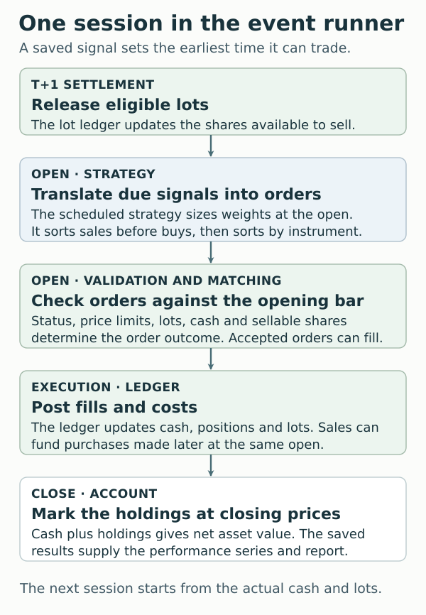

# How a TradeMaster run works

TradeMaster splits research and simulation across a clean language boundary: Python ingests market and fundamental data, enforces point-in-time (PIT) visibility, computes factors, and expresses portfolio decisions, while a deterministic Rust kernel validates trading permissions, executes orders in fixed-point arithmetic, maintains the FIFO lot ledger, and values account equity. The same strategy logic can execute through either of two simulation paths depending on how orders are scheduled and sized:

| Execution path | Decision and opening mechanics | Saved output |
|---|---|---|
| Daily portfolio snapshot | At each scheduled close, the native Rust extension values the account and passes actual holdings and recent fills to Python (or reads precomputed dated targets), which specifies complete portfolio weights as of that session's decision cutoff. Before the next open, Rust separately determines final whole-lot order quantities from previous closing marks and sets aside uninvested target equity plus a cash reserve priced at the buy cap (`buy_cap_ppm`) including fees—fixing every buy quantity before opening prices are observed, so proceeds from today's sales enter the buy budget only at the next session's open. | `BacktestResult` records daily equity and per-batch target outcomes, with optional attempt, order, fill, and position tables. Calling `result.save()` writes a replayable `request.json` and `result.json`. [Snapshot API](../reference/snapshot-backtest.md) · [Daily execution diagram](../../specs/assets/code-architecture-refactor.svg) |
| Saved market events | Python packages dated signals, timestamped market bars, and instrument specifications into a self-contained event request. At each eligible `session_open`, `ScheduledSignalStrategy` converts target weights into share quantities using that morning's opening marks and processes sells before buys in deterministic instrument order, allowing same-morning sale proceeds to fund new purchases immediately. | The Python orchestrator publishes a v3 run bundle containing the canonical request, executed artifact tables, source data provenance, report inputs, and rendered HTML report. [Event runner](../reference/execution.md) |

The [saved-event workflow diagram](trademaster-overview.svg) traces an event run from provider ingestion through report generation, while the session timeline below illustrates the exact intraday ordering within the Rust event loop.

## Data, factors and event-run artifacts

Subsystem boundaries separate data transformations from execution state so that cached inputs can be verified independently at every stage:

- **Point-in-time data snapshots.** `DataPortal` normalizes Tushare observations into content-addressed Parquet objects and indexes coverage in DuckDB. Publishing a **data snapshot** binds the normalized requests and source Parquet digests into an immutable manifest, while point-in-time queries filter rows strictly by their `as_of` cutoff so strategies see only information published by decision time.
- **Managed factors and cross-sectional evaluation.** Each versioned `FactorDefinition` uniquely identifies its calculation code, parameters, and upstream factor dependencies, storing outputs in Parquet while indexing definitions, materializations, and evaluations in DuckDB. Strategies consume factor scores available at the decision cutoff to rank instruments, whereas factor evaluators join those same scores against subsequent forward returns without compounding overlapping holding periods. [Factor and label data flow](trademaster-data-flow.svg)
- **Pluggable execution and modular policy traits.** On the event path, Python submits scheduled signal batches to the Rust runner, while native Rust callers can implement `StrategyAdapter` directly to emit `OrderIntent` records inside the same `EventLoop`. Venue calendars, order validation rules, T+0/T+1 share settlement, fee schedules, and FX rate providers sit behind distinct Rust traits, with the settlement calendar supplying eligible trading sessions per venue.
- **Content-addressed artifacts and v3 run bundles.** Every persisted event record carries a `run_id`, monotonic `event_seq`, and deterministic secondary sort key. Standard v1 run verification validates eleven related Parquet tables—including a cryptographic hash chain across `AccountSnapshot` transitions—and checks file digests, row counts, and run identities against `RunManifest`. Around these artifacts, the v3 strategy bundle links the rendered HTML report (including benchmark comparisons and point-in-time sector and size exposures) all the way back to stock selections, factor materializations, data snapshots, and raw Rust inputs and outputs.

## A weekly momentum signal through the event runner

Consider a cross-sectional strategy that ranks A-shares by 60-day momentum at Friday's close (using a data snapshot whose `as_of` cutoff is Friday's post-close decision timestamp) and targets equal weights across the top twenty names for Monday's open:

1. **Snapshot binding.** `DataPortal.snapshot()` freezes the canonical data requests, coverage ranges, availability rules, and content-addressed Parquet files for daily bars, trading status, suspensions, and daily price limits.
2. **Dependency resolution.** `ManagedFactorRegistry` validates the factor DAG and rejects circular dependencies, after which `FactorManager` derives a deterministic cache key from the factor definition, input data snapshot, table digests, universe, date range, and upstream materializations.
3. **Materialization verification.** Before ranking candidates, Python reloads the persisted factor Parquet table and verifies its SHA-256 digest, Arrow schema, row count, and lineage metadata, allowing strategies to consume verified single-factor or composite scores directly.
4. **Causal signal stamping.** The signal generator stamps each target row with Friday's close as its decision timestamp and the next trading session's open as its earliest eligible execution timestamp, preventing same-bar execution on closing prices.
5. **Deterministic open ordering.** `EventLoop` advances strictly through settlement, `session_open`, and `session_close` events. At Monday's open, target-weight execution submits all sell intents before buy intents, ordering instruments lexicographically by `instrument_id` within each side so changing signal IDs never alters capital allocation.
6. **Distinct execution and accounting records.** Accepted orders that fill emit typed `Fill` and accounting entries, while rejected or expired orders preserve structured diagnostic codes without mutating balances; valid terminal outcomes that leave balances unchanged record an explicit empty `LedgerEffect`.
7. **FIFO lot settlement and valuation.** Prior to trading on subsequent sessions, settlement unlocks T+1 lots that have reached their eligible date, and `LotLedger` snapshots preserve exact fixed-point cash, per-lot holdings, sellable quantities, and closing net asset value (NAV).
8. **Downstream reporting vs. signal diagnostics.** Reporting modules compute realized return series, fee breakdowns, historical style/sector exposures, and benchmark-relative metrics strictly from the Rust ledger's NAV and fill records, whereas factor research independently evaluates IC, rank IC, quantile returns, long-short spread, and signal turnover.

## Data gaps and execution evidence

TradeMaster surfaces missing evidence and contract violations at the boundary where they arise rather than interpolating missing market state:

- **Acquisition and market evidence.** During data collection, the Tushare downloader fetches missing date ranges and fails explicitly on permission errors, truncated pagination, or unexpected schemas. A documented suspension record explains an absent daily OHLCV bar; an unexplained missing bar is counted as a coverage gap in research panels and halts daily snapshot execution when valuation or opening evidence is required (see the [daily snapshot missing-data contract](../reference/snapshot-backtest.md#missing-prices-and-opening-evidence)). Event-runner execution likewise requires verified trading status and daily price limits, using explicit `DailyLimitRuleEvidence` where exchange rules govern ETF price bands.
- **Immutable factor lineage and causal execution.** Modifying a factor's calculation logic or parameters under an existing `ID@VERSION` is rejected; `FactorManager` refuses corrupted Parquet caches, conflicting registrations, or missing parent materializations until a new version is published. Any signal derived from a session's close cannot execute before a subsequent market event, and if any ledger posting fails invariant checks, `LotLedger` rolls back the entire state transition atomically.

One legacy workflow—the historical ten-year industry rotation study—carries documented exceptions for early data coverage and adjusted execution prices; consult its [historical reproduction notes](../../python/trademaster/strategies/industry_fundamental_top5/README.md) when interpreting those archives. For the architectural rationale behind separating close-time portfolio targets from pre-open cash reservation, see the [code architecture specification](../../specs/20261104-code-architecture-refactor.md).
