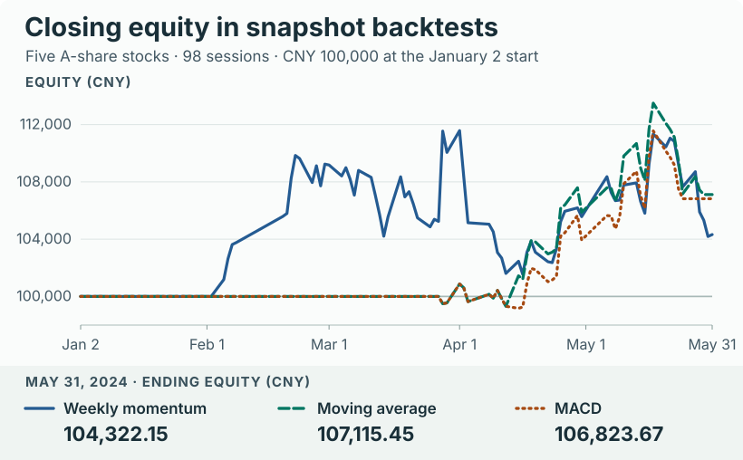

# From target weights to a daily account

A strategy sees the prices and factors available at its decision time. It returns a complete set of portfolio weights. Rust uses the previous closing prices to plan orders, checks each side at the next open and posts fills to one ledger. The cash left outside the stock weights is reserved before sizing buys. Sale proceeds first enter the buy budget at the following open.

## A blocked sale

Run the acceptance example without a data account.

```bash
uv sync --locked --extra dev
uv run python specs/examples/blocked_rotation.py
uv run tm-replay artifacts/blocked-rotation/request.json
```

The strategy returns `{"B": Decimal("0.80")}` on Friday. It starts with 8,000 sellable shares of A and CNY 20,000. A fill costs CNY 5, the buy price cap is 2% above the previous close, and the target can be attempted on three opens.

| Session | Execution | Cash (CNY) | Closing equity (CNY) |
|---|---|---:|---:|
| Friday | Register the target after the close. | 20,000 | 100,000 |
| Monday | A is at its lower limit. The sale is rejected. All cash is reserved. | 20,000 | 92,000 |
| Tuesday | Sell A at 9. The opening buy budget of 1,600 is below the cost of one B lot at its cap. | 91,995 | 91,995 |
| Wednesday | Buy 3,600 shares of B at 20. | 19,990 | 91,990 |

The saved result contains three orders, two fills, and both the rejected A sale and the unplaced B demand. Inspect `attempts` for the reserved cash, buying budget and shortfalls at each open. [Executable example](../../specs/examples/blocked_rotation.py) · [Rust acceptance tests](../../crates/tm-engine/tests/snapshot_backtest.rs)

## Three strategies on the same market

Starting from CNY 100,000, both engines received the same 17 weekly momentum targets, three moving-average targets and five MACD targets. The Tushare sample spans January 2 through May 31, 2024. Each engine valued all 98 closes.

| Strategy | Fills, event → snapshot | Ending equity, event → snapshot (CNY) | Change (CNY) | Total fees, event → snapshot (CNY) | Closes with a different equity |
|---|---:|---:|---:|---:|---:|
| Weekly cross-sectional momentum | 31 → 48 | 104,666.94 → 104,322.15 | −344.79 | 696.06 → 787.85 | 74 of 98 |
| 5/20 moving average | 2 → 2 | 107,115.45 → 107,115.45 | 0.00 | 114.55 → 114.55 | 0 of 98 |
| 12/26/9 MACD | 4 → 5 | 106,825.69 → 106,823.67 | −2.02 | 224.31 → 228.33 | 31 of 98 |



On February 26 the momentum strategy sold 1,600 shares of 600036.SH in both runs. The event runner bought 5,000 shares of 000001.SZ that morning. The snapshot runner could fund 100 shares before the sale, bought another 4,900 the next morning and adjusted the position again on February 28. The separate fills changed both exposure and fees. Its final Friday decision had no eligible open left in the sample.

Both timing strategies first bought 3,000 shares of 600036.SH on March 28. The moving-average strategy had the same entry, exit and cash balance throughout. MACD differed on April 16. The event runner bought 3,000 shares at once, while the snapshot runner bought 2,900 and added 100 on April 17. Those 100 shares cost 32.69 instead of 32.71 each, saving CNY 2.00. The extra fill raised fees by CNY 4.02, leaving ending equity CNY 2.02 lower.

## Python SDK before and after the native extension

Both SDKs ran the same three Python strategies on the five-stock, 98-session TuShare snapshot above. Every dated target and the complete Rust results matched in all six comparisons, including missed orders, fill prices, fees and every closing equity value. Only the new SDK supplied each strategy with its actual closing account and recent fills.

Milliseconds below are medians from 25 trials after one warm-up per mode, on an AMD Ryzen 7 8845H under WSL2, Python 3.12.3 and release Rust 1.97.1. Each pair reads **process SDK → native SDK**. The first run includes opening and indexing a fresh snapshot. The repeat runs the strategy again on the same open snapshot with a new account. “Strategy” measures time inside the Python strategy method on repeat runs. The first two runtime columns overlap because the first run includes the open.

| Strategy and output | Callbacks | Snapshot open (ms) | First run incl. open (ms) | Repeat (ms) | Strategy (ms) |
| --- | ---: | ---: | ---: | ---: | ---: |
| Weekly momentum, detail | 21 | 5.90 → 6.16 | 10.58 → 8.97 | 4.68 → 2.54 | 0.14 → 0.24 |
| Weekly momentum, summary | 21 | 5.77 → 6.22 | 9.99 → 8.53 | 3.99 → 2.07 | 0.17 → 0.21 |
| Moving average, detail | 98 | 5.92 → 6.38 | 9.98 → 8.64 | 3.93 → 1.87 | 0.84 → 0.89 |
| Moving average, summary | 98 | 6.00 → 6.16 | 9.86 → 8.30 | 3.82 → 1.81 | 0.89 → 0.88 |
| MACD, detail | 98 | 6.00 → 6.16 | 11.22 → 9.99 | 5.10 → 3.24 | 1.93 → 2.03 |
| MACD, summary | 98 | 5.80 → 6.28 | 10.96 → 9.71 | 4.88 → 3.16 | 1.96 → 2.04 |

The native SDK prepares the Rust market index at snapshot open and reuses it on every subsequent run. On this sample the repeated detailed runs save about two milliseconds each. The timing script uses the original MACD implementation, which recalculates exponential averages from its full visible price history. The [current snapshot demo](../../README.md#write-a-strategy) updates the same averages once per close.

The table records a historical comparison. Its process-based SDK and the manifest identifying the measured binaries were kept in the original local benchmark environment. The public repository includes the [timing script used for those measurements](https://github.com/Obscurepawn/TradeMaster/blob/5dc86ce81f45de862c42c24c2e074187d623fcf5/specs/examples/profile_backtest.py).

To measure the current SDK, first prepare the shared five-stock snapshot. The command below rotates the strategy order and writes every sample, plus a hash of each strategy’s targets and ledger, to `artifacts/native-timings.json`. [Prepare the snapshot](tushare-strategies.md#run-the-examples) · [Current timing script](../../specs/examples/profile_backtest.py)

```bash
uv run python specs/examples/profile_backtest.py artifacts/demo-snapshot/snapshot --repeats 25 --output artifacts/native-timings.json
```

## Historical command-line timings

The original process-based comparison recorded elapsed milliseconds for one release runner process. Each strategy had one warm-up and 15 timed runs per mode, rotating the starting order. The clock starts before creating the process and stops after its JSON result arrives. Snapshot times include checking the manifest and reading the market file. The event request already contains its market events. Preparing Tushare data, running the Python strategy and generating reports are outside this measurement.

| Strategy | Original event detail (ms) | Snapshot detail (ms) | Snapshot summary (ms) | Peak RSS in KiB, event → detail → summary |
|---|---:|---:|---:|---:|
| Weekly momentum | 23.03 | 3.48 | 3.11 | 9,020 → 3,800 → 3,516 |
| Moving average | 8.11 | 2.52 | 2.39 | 5,052 → 3,668 → 3,536 |
| MACD | 7.66 | 2.25 | 2.24 | 5,180 → 3,576 → 3,532 |

Times are medians on an AMD Ryzen 7 8845H, Linux x86-64 under WSL2, Rust 1.97.1 and Python 3.12.3. Peak RSS comes from a separate process per mode. Each timed replay produced the same bytes as its warm-up. Summary and detail agreed on all daily account values, target outcomes, order and fill counts, turnover and costs.

A separate run of the complete Python commands took **3.77 seconds** for the event path and **2.71 seconds** for the snapshot path, each running all three strategies from the same local data into a fresh directory. The event command also writes and verifies HTML audit bundles. The snapshot command writes one shared market plus portable requests and ledger results. Both full commands peaked near 475 MiB, mostly outside the Rust execution measured above.

In this historical run, the momentum and moving-average callbacks read up to 21 sessions and MACD recalculated its averages from the full price history. The current example updates MACD once per session. For repeated runs with the same decisions, pass a dated table of targets to reuse them.

## Repeat the Tushare comparison

Follow the five-stock guide to prepare the data and generate the event bundles. Keep the same `DATA_ROOT` and `PLAN` in your shell for the comparison below. Both engines use the same candidate stocks, indicator parameters, opening permissions and costs. The published comparison used 392 source objects for 490 stock-days. [Prepare the TuShare runs](tushare-strategies.md#run-the-examples)

```bash
uv run python -m trademaster.e2e.compare_rebalance \
  --data-root "$DATA_ROOT" --plan "$PLAN" \
  --legacy-root artifacts/demo-strategies --repeats 15
```

The comparison verifies the event bundles, replays their requests and checks that the two engines received the same dated targets. The May 31 decision is first eligible on June 3, after the sample’s final valuation.

Under `artifacts/rebalance-comparison/`, `comparison.json` records the snapshot ID, engine identification, costs, target outcomes and all timing samples. The per-strategy files let you trace each difference back to the opening trade.

| File | Contents |
|---|---|
| `trades.csv` | Shares, volume-weighted fill prices and costs for both paths, grouped by session, instrument and side. |
| `equity.csv` | Cash and equity for both paths at every close, plus the equity difference. |
| `request.json` | A portable request pointing to the shared snapshot in the parent directory. |
| `result.json` | Orders, fills, reasons for missed trades, fees, daily valuations and per-target attempts. |
