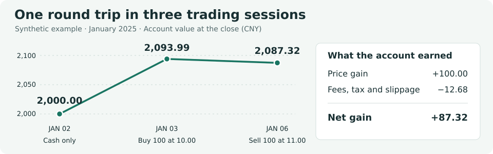

# Execution and results

This reference defines the contract for TradeMaster's event-driven simulation runner, the shared fixed-point Rust accounting kernel (`tm-core` and `tm-engine`), end-to-end v3 run bundles, and HTML performance reporting. For recurring close-time portfolio targets with pre-open cash reservation and multi-session retry budgets, use the [daily snapshot API](snapshot-backtest.md).

## Event runner

The JSON event runner executes timestamped market streams and scheduled signals inside a deterministic state machine. Each request supplies `InstrumentSpec` definitions, a fee schedule, ordered market events (`settlement`, `session_open`, and `session_close`), and dated signals. At each `session_open`, `ScheduledSignalStrategy` translates eligible signals into `OrderIntent` records, `OrderValidator` checks trading permissions and resource limits, `ExecutionModel` fills or expires accepted orders, and `LotLedger` posts exact accounting transitions (`LedgerEffect`). Settlement events unlock T+1 lots before trading begins, and `session_close` events mark held positions to market in an `AccountSnapshot`. Because intents, accepted orders, fills, rejections, expiries, ledger postings, and account snapshots are distinct domain types, an attempted order is never conflated with an executed trade. [Runnable request](../examples/round-trip.json) · [Event architecture](../architecture/overview.md)

| Boundary | Implementation and entry points |
|---|---|
| Python request and bundle | [e2e package](../../python/trademaster/e2e/__init__.py) defines `RunnerRequest`, `RunnerSignal`, `RunnerEvent`, `RunnerBar`, and `E2ERunnerClient.execute()`, passing canonical request bytes to the native extension and writing the request, result, report inputs, and HTML report. `verify_e2e_bundle()` validates stored digests, replays execution, and regenerates the report. [Orchestrator tests](../../tests/test_e2e_orchestrator.py) · [Bundle rules](../../python/trademaster/e2e/AGENTS.md) |
| Fixed-point and accounting records | [tm-core library](../../crates/tm-core/src/lib.rs) defines `Fixed8` (`10^8`-scaled exact integers for prices and money), integral `Quantity`, `InstrumentSpec`, `MarketBar`, `OrderIntent`, `OrderExecution`, `LedgerEffect`, and `AccountSnapshot`. `typed_artifact_record_batch()` materializes Arrow batches and `validate_run_artifact_rows()` checks cross-table invariants and hash chains. [Crate rules](../../crates/tm-core/AGENTS.md) |
| Rules and state | [tm-engine library](../../crates/tm-engine/src/lib.rs) implements `EventLoop`, `ScheduledSignalStrategy`, `CnAshareOrderValidator`, `DailyBarExecutionModel`, `CnFeeSchedule`, and the FIFO `LotLedger`. `StrategyAdapter` consumes causal decision views, `OrderValidator` and `ExecutionModel` govern order lifecycles, `Ledger` owns cash and dated lots, and `TradingCalendar`, `FeeSchedule`, and `FxRateProvider` isolate venue policies. [Crate rules](../../crates/tm-engine/AGENTS.md) |
| Event and replay interface | [tm-runner](../../crates/tm-runner/src/lib.rs) decodes saved wire requests and serializes execution outputs; [native replay](../../crates/tm-python/src/replay.rs) exposes both engines to Python, and [tm-replay](../../python/trademaster/replay.py) dispatches saved event or snapshot JSON files from the CLI. [Event wire tests](../../crates/tm-runner/tests/wire.rs) · [Snapshot and saved-event replay tests](../../crates/tm-runner/tests/snapshot_replay.rs) · [Crate rules](../../crates/tm-runner/AGENTS.md) |
| Metrics and HTML | [reporting package](../../python/trademaster/reporting/__init__.py) derives `PerformanceSeries`, `StrategyMetrics`, and trade summaries from executed ledger outputs while aligning benchmarks and point-in-time exposures separately; `build_html_report()` renders self-contained HTML from recorded report inputs. [Metrics tests](../../tests/test_reporting_metrics.py) · [HTML tests](../../tests/test_reporting_report.py) · [Reporting rules](../../python/trademaster/reporting/AGENTS.md) |

Unlike the daily snapshot planner, target-weight signal batches on the event path sum to `1` when invested (or `0` when exiting to cash) and size share quantities directly from `session_open` marks, executing sells before buys in lexicographic `instrument_id` order so same-morning sale proceeds can fund purchases immediately.

Venue constraints on event requests default to A-share rules but can be relaxed explicitly for other markets or frictionless studies:

- **Price-limit enforcement.** `enforce_price_limits` defaults to `true` (omitted when serialized as `true` so existing request digests remain unchanged, and written explicitly when `false`). Setting `enforce_price_limits: false` disables upper-limit buy rejections and lower-limit sell rejections and permits omitting `up_limit_scaled` and `down_limit_scaled` (`None` on `MarketBar`); if either bound is supplied, both must be positive and ordered, and `enforce_price_limits: true` requires both. Direct Rust callers configure the same behavior via `CnAshareOrderValidator::new(fees).with_price_limits(false)`. Causal signal timing, trading suspensions, lot granularity, cash sufficiency, and sellable-share checks remain enforced in both modes.
- **Lot granularity, settlement lag, and fees.** On each `InstrumentSpec`, `buy_lot_size: 1` enables single-share orders and `settlement: "t0"` makes newly bought lots immediately sellable (governing share resale eligibility rather than clearinghouse cash settlement). Setting `sell_stamp_duty_ppm` and `sse_transfer_fee_ppm` to `0` removes statutory levies, and setting both `commission_ppm` to `0` and `minimum_commission_scaled` to `"0"` produces zero-commission fills. Accounts remain long-only, integral-share, and unlevered.

To diagnose a rejected order in saved wire output, inspect its `code` and `message` in `rejections` and join `order_id` against `orders` to recover the `instrument_id` and `side`. For price-limit rejections, match `event_time` to the corresponding `session_open` event in the request and compare `open_scaled` against `up_limit_scaled` and `down_limit_scaled`. Executed entries in `fills` likewise carry `order_id` and `event_time` alongside filled quantity, execution price, and itemized transaction charges.

## Replay the three-session example

From the repository root, replay the checked-in three-session JSON request, which starts with `CNY 2,000` cash, buys `100` shares at the next open, and liquidates the position on the third session:

```bash
uv run tm-replay docs/examples/round-trip.json > result.json
```



On January 3, the account buys `100` shares at `CNY 10.00` and marks them at `CNY 11.00` at the close (`CNY 2,093.99` NAV after entry costs). After T+1 settlement unlocks the lot for January 6, the account sells at `CNY 11.00`, turning the `CNY 100.00` gross price gain into **CNY 87.32 net of transaction costs** (`CNY 2,087.32` ending NAV). Because wire fields store prices and monetary amounts as integers scaled by `100,000,000` (`10^8`), divide by `100_000_000` in Python to inspect human-readable fills and closing NAV:

```bash
python3 - <<'PY'
import json
from decimal import Decimal
from pathlib import Path

result = json.loads(Path("result.json").read_bytes())
unit = Decimal(100_000_000)
for fill in result["fills"]:
    print(fill["side"], fill["quantity"], f'@ {Decimal(fill["price_scaled"]) / unit:.2f}')
print(f'Ending balance: {Decimal(result["nav"][-1]["net_asset_value_scaled"]) / unit:.2f}')
PY
```

```text
buy 100 @ 10.00
sell 100 @ 11.00
Ending balance: 2087.32
```

To observe a deterministic validation rejection, copy [round-trip.json](../examples/round-trip.json), change `initial_cash_scaled` to `"100000000"` (`CNY 1.00`), and rerun `tm-replay`: the first entry in `rejections` flags `order:buy` at `2025-01-03T01:30:00Z` with `code: "insufficient_cash"`, and the matching record in `orders` identifies the blocked `100`-share buy of `600000.SH`. Modifying signal targets or fee rates in the request file updates orders, fills, rejections, cash, positions, and step-by-step NAV accordingly.

## Market samples and strategy runs

End-to-end Python harnesses bridge verified research caches to both Rust execution engines:

| Module | Architectural responsibility |
|---|---|
| [demo_data.py](../../python/trademaster/e2e/demo_data.py) | `load_demo_market()` loads a completed acquisition plan, re-verifies raw Parquet digests, converts Tushare lot volumes into whole shares, and packages `DemoMarket` with verified sessions, `next_session`, bars, trading status, exact price limits, and constant adjustment factors. [Offline loader regressions](../../tests/test_demo_data.py) |
| [demo_runner.py](../../python/trademaster/e2e/demo_runner.py) | `run_demo_strategy()` translates close-time strategy decisions into next-open `RunnerRequest` payloads and archives the resulting v3 bundle and HTML report. [Next-open and archive test](../../tests/test_demo_runner.py) |
| [demo_strategies.py](../../python/trademaster/e2e/demo_strategies.py) | `run_demos()` executes three benchmark strategies through the event runner with full HTML reports, while `run_snapshot_demos()` runs the same three strategies against a shared data snapshot and saves replayable requests and results. [Workflow and data verification tests](../../tests/test_tushare_demo_strategies.py) |
| [compare_rebalance.py](../../python/trademaster/e2e/compare_rebalance.py) | `compare()` validates original event bundles, aligns dated target weights across engines, joins executed trades and daily equity series, and benchmarks native replay latency. [Method and results](../examples/rebalance-comparison.md) · [Comparison tests](../../tests/test_rebalance_comparison.py) |
| [real_tushare.py](../../python/trademaster/e2e/real_tushare.py) | `run_real_tushare_e2e()` exercises cross-sectional stock selection and ETF timing end to end across `DataPortal`, Rust execution, and warm-cache reloads, recording `DailyLimitRuleEvidence` where venue rules supply ETF price bands. [Live integration tests](../../tests/test_real_tushare_e2e.py) |

## Schemas and Rust regressions

Cross-language persistence contracts are anchored in [`crates/tm-core/schemas/`](../../crates/tm-core/schemas/) and surfaced in Python via [contracts.py](../../python/trademaster/contracts.py), which exposes runtime protocols alongside `RunManifest`, `run_artifact_schemas()` (Arrow table schemas), `validate_run_artifacts()` (relational and ordering invariants), and `verify_run_manifest()` (digest and row-count checks). The canonical [artifact schema](../../crates/tm-core/schemas/run-artifacts-v1.json) specifies all eleven event-run tables and their sort keys, while the [manifest schema](../../crates/tm-core/schemas/run-manifest-v1.json) and [golden fixture](../../crates/tm-core/schemas/run-manifest-v1.fixture.json) lock in byte-compatible serialization across Python and Rust. [Schema overview](../../schemas/README.md) · [Schema ownership rules](../../schemas/AGENTS.md) · [Canonical-file rules](../../crates/tm-core/schemas/AGENTS.md)

| Area of change | Required regression suites |
|---|---|
| Shared types or schemas | [Python/Rust schema agreement](../../tests/test_schema_golden.py), [public Python interfaces](../../tests/test_public_interfaces.py), [Rust public constructors](../../crates/tm-core/tests/public_contract.rs), [exact values and account invariants](../../crates/tm-core/tests/contract_behavior.rs), [manifest fixture](../../crates/tm-core/tests/shared_schema.rs), [Arrow conversion](../../crates/tm-core/tests/artifact_arrow.rs), and [typed record materialization](../../crates/tm-core/tests/typed_artifacts.rs). |
| Execution inputs, limits, or costs | [A-share validation and fees](../../crates/tm-engine/tests/a_share_rules.rs), [open fills and stale bars](../../crates/tm-engine/tests/daily_execution.rs), and [quantity conservation and ordering](../../crates/tm-engine/tests/strict_execution.rs). |
| Lot ownership and event ordering | [T+1 and FIFO lots](../../crates/tm-engine/tests/lot_ledger.rs), [scheduled targets](../../crates/tm-engine/tests/scheduled_strategy.rs), and [settlement before the next open](../../crates/tm-engine/tests/unified_event_loop.rs). |
| Extension traits | [Object safety](../../crates/tm-engine/tests/public_traits.rs) and [implementing runtime traits from another crate](../../crates/tm-engine/tests/implementable_contracts.rs). |

## Older event archives

Schema and report-input versioning keeps historical event bundles inspectable without silently altering past published figures. Current event bundles write `"monthly_return_basis": "previous_month_close"` into `report-input.json`, whereas earlier archives omit that key and measure each monthly return from the first equity observation inside that calendar month; `verify_e2e_bundle()` regenerates HTML using whichever convention the bundle recorded. To recompute historical examples under the month-end convention, rerun them into a fresh output directory using the [five-stock report commands](../examples/tushare-strategies.md#run-the-examples).

The three Tushare demo bundles analyzed in the [engine comparison](../examples/rebalance-comparison.md) reproduce both their saved ledger bytes and rendered HTML byte for byte. Two earlier pre-migration archives illustrate how versioned contracts isolate format evolution: on the January 2025 cross-sectional sample, both the pre-migration CLI binary and the current native extension produce identical trades and daily equity, though sorting signal rows by `signal_id` in the legacy archive yields a distinct raw file hash; on the early ETF archive, replay reproduces exact ledger bytes while verification stops before HTML regeneration because `report-input.json` predates current report fields. Both legacy requests and reports remain intact for audit.
