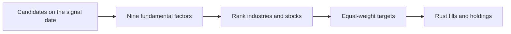

# Industry fundamental strategy

This strategy ranks historical CSI 300 constituents on nine fundamental factors each May and November. It selects up to five stocks per eligible SW2021 industry by default and assigns equal target weights across all picks. Use this package for the public Python API and command-line entry point.



## Choose the portfolio

| Portfolio | CLI options |
| --- | --- |
| Up to five stocks per eligible industry (default) | `--top-per-industry 5` |
| One stock per eligible industry | `--top-per-industry 1` |
| One stock in each of the ten highest-scoring industries | `--top-industries-by-mean-score 10 --top-per-industry 1` |

The industry-relative composite ranks stocks within each industry. When you also select industries, the strategy ranks each industry by its members’ average global composite score. When scores tie, the lower instrument or industry ID comes first. Requesting ten industries with fewer than ten eligible groups stops selection.

## Try the selection on a small portfolio

From the repository root, run the selection test with nine sample stocks across two industries.

```bash
uv run --locked --extra dev pytest -q \
  tests/test_industry_fundamental_top5.py::test_selects_top_five_per_industry_with_stable_ties_and_exact_equal_weights
```

The test prints `1 passed`. It checks that five stocks from the first industry and three from the second receive 12.5% each. It exercises the ranking and target weights using local inputs. [Fixture and expected selections](../../../../tests/test_industry_fundamental_top5.py)

## Check coverage for the ten-year Top1 run

The default research period is **2016-08-12 through 2026-08-11**, with **CNY 500,000** in starting cash. This configuration selects one stock per industry using membership as of each signal date. The CLI reads cached requests from local Parquet and uses `TUSHARE_TOKEN` for the provider client. Export the token in your shell before running the command from the repository root.

```bash
uv run --locked python -m trademaster.strategies.industry_fundamental \
  --data-root data/strategies/industry-fundamental-top5-10y \
  --output-root artifacts/strategies/industry-fundamental-managed \
  --top-per-industry 1
```

With the audited cache at that path, the expected result is `historical industry interval is unavailable for 000009.SZ at 2016-11-07`. Its first recorded industry interval starts on 2021-07-30. The run stops before selection and Rust execution. Completing a historical run requires dated membership for every candidate on each signal date. [Historical coverage audit](../../../../specs/20260823-m9-full-a-20y-factor-evaluation-quality.md)

## Read a completed run

With complete inputs, the command prints JSON containing paths to the HTML `report`, the `markdown_report` and the `summary`. The summary lists the final cash weight, rejected orders, and holdings outside the final target. Within a target batch, the runner processes sells first and uses instrument ID for stable ordering.

The `bundle_manifest` links the candidate snapshots, 11 factor definitions and their values at each rebalance, stock selections, Rust request and result, and reports. The report annualizes weekly valuations using 52 periods per year. For a missing daily price with a prior close, this strategy carries the price forward and marks the stock suspended. Its share counts and fees reflect trading on adjusted prices.

[Factor definitions and lineage](../../../../docs/factor-management.md) · [Historical data and accounting limits](../industry_fundamental_top5/README.md#historical-data-and-accounting) · [Public Python API](__init__.py)
