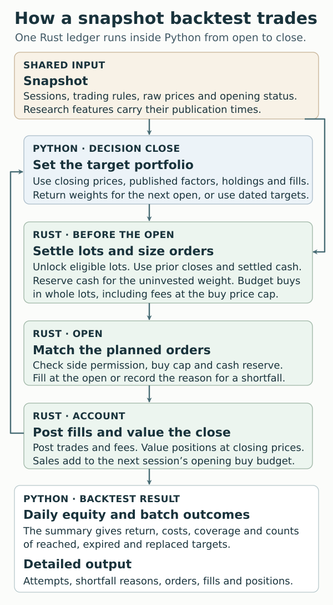

# Code Architecture Refactoring: Daily Snapshot SDK and Rust Portfolio Sizing

**Status:** Active (Core SDK Completed; Legacy Industry Strategy Migration Open) | **Date:** 2026-11-04 | **Scope:** Whole-portfolio daily snapshot backtest SDK, Rust order sizing and dividend ledger, and Tushare Pro example migrations (`trademaster.backtest`, `tm-engine`, `tm-runner`) | **Updated-by:** [Python and Rust Native Backtest Interface](20261105-python-rust-backtest-interface.md)

> **Implementation Status:** The daily **data snapshot** SDK (`trademaster.backtest`), Rust portfolio sizing, opening execution, and cash-dividend ledger (`tm-engine`), and the three 98-session Tushare Pro examples were completed on `2026-11-04` ([walkthrough and measured comparison](../docs/examples/rebalance-comparison.md)). On `2026-11-05`, the [Python and Rust Native Backtest Interface](20261105-python-rust-backtest-interface.md) moved the daily loop in process via `tm-python` and passed closing accounts and recent fills to scheduled `on_close` callbacks. Migrating the legacy `industry_fundamental` (`industry_fundamental_top5`) long-history workflow from the event runner to whole-portfolio daily snapshots remains open.

## Motivation: Whole-Portfolio Targets vs. Pre-Sized Event Signals

Evaluating multiple strategies over the same market history requires comparing net returns after trading costs, maximum drawdowns, and unfulfilled target rates under identical trading assumptions.

In the v1 event runner (at commit `80834872`), custom backtests assembled dated signals, instrument metadata, session opens, and market bars for Rust execution. While Python could emit target-weight intents, `ScheduledSignalStrategy` accepted a target-weight batch only when weights summed to exactly `0` or `1`—rejecting partial equity allocations such as an `80%` weight in `B` paired with a `20%` cash reserve—and forced the legacy `industry_fundamental` strategy to track dropped constituents in Python and schedule explicit zero-weight exit signals across up to 20 subsequent opens ([Runner request](../python/trademaster/e2e/__init__.py#L119-L151) · [Weight validation](https://github.com/Obscurepawn/TradeMaster/blob/80834872a29bbbd083bd5edfecbdf3fec0b19099/crates/tm-engine/src/lib.rs#L154-L181) · [Exit scheduling](../python/trademaster/strategies/industry_fundamental_top5/real.py#L1010-L1035)).

Drawing on Qlib's `WeightStrategyBase` and RQAlpha's `order_target_portfolio_smart` ([Qlib strategy implementation](https://github.com/microsoft/qlib/blob/54355232463878d2eebb91fe0ee5fa7fa1f5976c/qlib/contrib/strategy/signal_strategy.py#L344-L371) · [RQAlpha portfolio API](https://rqalpha.readthedocs.io/zh-cn/latest/api/base_api.html#rqalpha.api.order_target_portfolio_smart)), the refactored snapshot architecture lets Python declare the complete target portfolio over a reusable **data snapshot**, while Rust plans daily orders from prior closing marks, reserves cash, checks opening trade permissions, and retries unfulfilled targets automatically while the target remains active.



## Strategy Interface and Target Semantics

Each backtest accepts an open data snapshot, either one strategy object or one precomputed target table, an initial account (`initial_cash` or `initial_account` with starting lots), and a trading `Policy`. From the repository root, the [four-session example](../README.md#run-the-example) builds a self-contained snapshot whose Friday decision can be inspected directly:

```python
from datetime import date

from specs.examples.weekly_rotation import WeeklyRotation
from trademaster.backtest import Snapshot

snapshot = Snapshot.open("artifacts/blocked-rotation/snapshot")
weights = WeeklyRotation().on_close(snapshot.day(date(2024, 1, 5)))
print(weights)  # {'B': Decimal('0.80')}
```

In the runnable [strategy demo](examples/weekly_rotation.py) (`python3 specs/examples/weekly_rotation.py`), `on_close(day) -> dict[str, Decimal] | None` observes only features published at or before that session's `decision_at` as-of timestamp (`available_at <= decision_at`). It reads `day.scores("rotation_score")`, ignores missing or non-finite values, breaks ties by ascending `instrument_id`, and emits `{"B": Decimal("0.80")}` when `A` scores `0.35` and `B` scores `0.72`:

| `on_close` Return Value | Portfolio Meaning |
|---|---|
| `{"B": Decimal("0.80")}` | Replace the active target portfolio: allocate `80%` to `B`, reserve `20%` in cash, and exit any held positions omitted from the mapping. |
| `{}` | Target a `100%` cash account by liquidating all sellable holdings. |
| `None` | Issue no new decision; keep any active target in force until reached, replaced, or expired. |

Target weights are long-only and sum to at most `1`. Precomputed decisions can be passed via `targets=weight_batches` as an Arrow table where each row represents one decision date and its `weights` map holds all target weights for that batch:

| Precomputed `targets` Input | Resulting Engine Behavior |
|---|---|
| Zero-row table | Submits no target batches; starting holdings remain untouched throughout the run. |
| Single row with `weights=[]` | Targets all cash; Rust attempts to sell existing holdings starting at the batch's eligible open. |
| Decisions on Jan 8 and Jan 9 both eligible on Jan 10 | The newer Jan 9 batch governs the Jan 10 open, while the superseded Jan 8 batch is marked `replaced` with zero attempts. |

Callback decisions become eligible at the next trading session's open (`T+1`), whereas precomputed batches may specify a later calendar session (including the first session beyond the sample). Starting lots in `initial_account` specify an instrument, share count, and `sellable_date`; Rust unlocks mature lots at each session open prior to sizing, while any lot whose `sellable_date` lies beyond the snapshot calendar remains held and marked to market at close with zero sellable shares.

Summary mode returns net return, maximum drawdown, turnover, total costs, the expired-target shortfall rate, and data coverage; `detail=True` adds per-attempt records, orders, fills, and daily positions. `result.save(directory)` writes a replayable JSON request and Rust result alongside the snapshot, while the event workflow continues to render standalone Plotly HTML reports.

## Data Snapshot Contract and Missing-Data Handling

A **data snapshot** binds immutable market JSON and feature Parquet files, SHA-256 digests, session `decision_at` cutoffs, and corporate-action metadata under a single manifest ID:

| Snapshot Component | Stored Fields | Consumer and Causality Boundary |
|---|---|---|
| Sessions & instruments | Ordered trading dates, `decision_at` cutoffs, listing dates, board-lot size, price tick, and T+0/T+1 settlement lag. | Python resolves rebalance schedules (such as week-end sessions); Rust counts retry attempts and unlocks settled lots. |
| Point-in-time strategy features | `instrument_id`, feature name, numeric value, and `available_at` timestamp, plus universe and factor metadata. | Strategy `on_close(day)` reads only rows satisfying `available_at <= decision_at`; post-cutoff filings wait for a subsequent session. |
| Daily prices & opening permissions | Raw `open` and `close`, side-specific `buy_at_open` and `sell_at_open` (`yes`, `no`, or `unknown`), evidence references, and optional block reasons. | Order sizing reads the *previous* session's closing marks (adjusted for ex-date cash dividends); opening execution checks today's `open` and side status; closing valuation marks today's `close`. |
| Trading & cost policy | Corporate-action coverage flags alongside run-level commission, stamp duty, transfer fees, slippage, buy price cap, and max retry attempts. | Persisted in run results so strategies can be compared under shared assumptions or stress-tested under higher costs. |

Unlike the research panel's `tradable` flag—which checks closing validity without separating buy and sell restrictions ([Existing panel fields](../python/trademaster/research/full_a_panel.py#L119-L157) · [Current tradability calculation](../python/trademaster/research/full_a_panel.py#L926-L932))—snapshot producers compute `buy_at_open` and `sell_at_open` explicitly from price-limit and status evidence (for example, `sell_at_open="no"` with reason `lower_limit`, defaulting to `blocked_at_open` when no specific reason is supplied).

- **Suspensions and missing prices:** Under a documented suspension, the ledger carries forward the prior valuation mark (`carried_mark=True` in detailed positions). Unexplained missing rows or closes halt held positions at valuation (`missing_close`) and unheld target instruments during sizing (`missing_previous_close`), returning status `insufficient_data` with session, instrument, phase, and reason in `result.raw["first_issue"]` ([SDK guide to missing prices and opening evidence](../docs/reference/snapshot-backtest.md#missing-prices-and-opening-evidence)).
- **Unknown opening evidence and corporate actions:** If any planned order encounters an `unknown` opening permission, Rust aborts all fills for that attempt. If closing valuation fails after opening fills execute, completed fills remain recorded and the run stops before publishing that session's closing equity. Snapshot loaders flag unsupported corporate actions; the Tushare demo loader rejects intervals exhibiting `adj_factor` changes or breaks in `pre_close` continuity unless accounted for by explicit cash-dividend records.

## Rust Sizing, Cash Reservation, and Execution

```text
account.settle(session)
adjust_ex_dividend_marks_and_accrue_entitlements(account, previous_marks, session)
plan = size(active_target, account, previous_marks, sizing_policy)
fills, reasons = estimate_open(plan, today.open_columns, cost_policy)
account.apply(fills)
record_entitled_units_and_credit_payments_at_close(account, session)
equity = account.mark(today.close_columns)
```

| Stage Boundary | Responsibility |
|---|---|
| Python -> Rust | Supplies the verified data snapshot, initial account, and `Policy`, plus either precomputed target batches or scheduled `on_close` weights after each valued close. |
| Order sizing -> cash reservation | Separately finalizes integer order quantities from prior closing marks and sets aside the target cash reserve plus capped buy outlays before reading today's opening prices. |
| Opening execution -> lot ledger | Checks `buy_at_open` / `sell_at_open`, opening price against the buy cap, and reserved cash; emits fills or rejection reasons and posts fills plus fees atomically to cash and FIFO lots. |
| Closing valuation -> next session | Credits due dividend payments, marks holdings at today's close (`equity = cash + holdings_value + dividend_receivables`), and tracks target completion, expiry, or replacement. |

### Order Quantity Finalization and Cash Reservation

Setting order quantities and reserving cash are distinct pre-open steps:

1. **Finalizing order quantities:** Before inspecting today's opening prices, Rust takes each instrument's prior closing mark `P` (subtracting any cash dividend per share going ex today) and prior closing equity `E`. Sell orders are capped by unlocked sellable shares—rounding partial sales down to board lots while permitting an odd-lot full exit when all held shares are sellable. Buy targets round `E × weight / P` down to whole board lots, subtract existing holdings, and trim lots until affordable at the buy price cap including fees. When multiple buys compete for limited cash, Rust allocates budget proportionally to remaining value shortfalls and assigns residual whole lots in descending order of remaining shortfall value (breaking ties by ascending `instrument_id`). Once sized, order quantities are final for that open.
2. **Reserving cash:** With prior equity `E` and total target stock weight `W`, Rust sets aside an untouchable cash reserve of `E × (1 - W)` rounded up to the nearest cent, plus the worst-case cost (at the buy price cap including estimated fees) of all planned buy orders. Only settled cash already exceeding `E × (1 - W)` can fund buys; proceeds from sales executed at the same open enter account cash after execution and become available to fund buys starting at the *next* session's open. Because the reserve is fixed before trading, closing cash as a fraction of closing equity may drift above or below `1 - W`.

For cash dividends on raw prices, Rust counts entitled units at the in-sample record-date close, accrues the receivable into equity before sizing on the ex-date, and transfers the receivable into settled cash at the pay-date close so it can fund orders from the next open ([Dividend inputs and ETF account example](../docs/reference/snapshot-backtest.md#cash-dividends)).

*(Modeling limitation: eligible small orders fill in full at the recorded opening price plus configured fees and slippage; order-book queue position and market impact require intraday data outside daily snapshot scope.)* The expired-target rate divides targets remaining short after their final retry attempt by all reached or expired targets (reporting `"no observations"` when zero targets reach or expire, and counting replaced, truncated, or `insufficient_data` batches separately).

### Worked Example: Rotating from A into B with a 20% Cash Reserve

At Friday's close, the account holds `8,000` sellable shares of `A` at `CNY 10` (`CNY 80,000`) plus `CNY 20,000` cash (`CNY 100,000` equity), while `B` closes at `CNY 20`. The strategy emits `{"B": Decimal("0.80")}` valid for up to three opens (`100`-share lots, `CNY 5` flat fee per fill, `0` slippage, `102%` buy price cap):

| Session | Pre-Open Plan and Opening Outcome | Closing Account State |
|---|---|---|
| Friday | Mark initial portfolio and register `80% B` target for Monday's open. | `A`: 8,000 sh, cash `20,000`, **equity `100,000`**. |
| Monday | Set aside `20,000` cash reserve (`0` buy budget left for `B`); submit sell for `8,000 A`. `A` opens at `9` with `sell_at_open="no"` (`lower_limit`): rejected (`0` fee). `B` stays at `20`. | `A`: 8,000 sh, cash `20,000`, **equity `92,000`**. |
| Tuesday | Set aside `18,400` reserve (`1,600` excess cash is below one `B` lot at `2,045` capped cost); sell `8,000 A` at `9` for `71,995` net proceeds (available next open). `B` closes at `20`. | `0` shares, **cash & equity `91,995`**. |
| Wednesday | Set aside `18,399` reserve (`73,596` buy budget); finalize buy of `3,600 B` shares reserving `73,445` at the `20.40` cap including fee; fill at `20` for `72,005` actual outlay. | `B`: 3,600 sh, cash **`19,990`**, **equity `91,990`**. |

Cash finishes at `21.73%` (`CNY 19,990`) because adding one more lot would breach the reserve, and the `CNY 8,010` equity change equals `CNY 8,000` adverse movement on `A` plus `CNY 10` across two fills (3 submitted orders, 1 rejection, 2 fills). Modifying Monday's close leaves Monday's opening order quantities and outcomes unchanged, confirming strict close-to-open causality.

## Migration Status

| Phase | Implementation Artifacts | Verification Status |
|---|---|---|
| 1. Shared daily data snapshot | [Snapshot](../python/trademaster/backtest/snapshot.py) persists fixed-point market JSON, side-specific opening permissions, and Parquet features under a content-hashed manifest. | Completed — [SDK tests](../tests/test_snapshot_backtest.py) cover `decision_at` cutoffs, listing dates, missing prices, and tamper checks. |
| 2. Rust sizing, execution & dividends | [Sizing](../crates/tm-engine/src/snapshot/sizing.rs) finalizes quantities and cash reserves pre-open; [Execution](../crates/tm-engine/src/snapshot/execution.rs) checks opening permissions and updates `LotLedger`; [snapshot runner](../crates/tm-runner/src/snapshot.rs) validates saved requests. | Completed — [Four-session fixture](../crates/tm-engine/tests/snapshot_backtest.rs) matches the worked A-to-B ledger; legacy event archives remain unchanged. |
| 3. Python SDK & 98-session Tushare examples | [backtest](../python/trademaster/backtest/__init__.py) supports `on_close` callbacks and `targets=` tables; [three demo strategies](../python/trademaster/e2e/demo_strategies.py) run on both engines over identical Tushare observations. | Completed — [Rebalance comparison](../python/trademaster/e2e/compare_rebalance.py) verifies targets, fills, fees, and all 98 daily valuations across summary and detail modes. |
| 4. Legacy `industry_fundamental` migration | Publish side-specific opening permissions and corporate-action evidence for the multi-year fundamental universe, replacing Python share sizing and 20-day exit loops with whole-portfolio snapshot targets. | **Open** — Pending historical universe snapshot preparation, equity/rejection reconciliation against saved bundles, and memory/runtime benchmarks. |

Whereas the v1 event loop copied historical bars into each strategy view—scaling as `O(N × D × (D - 1) / 2)` across `D` sessions and `N` instruments ([Original history handling](https://github.com/Obscurepawn/TradeMaster/blob/80834872a29bbbd083bd5edfecbdf3fec0b19099/crates/tm-engine/src/lib.rs#L1403-L1412))—an open `Snapshot` indexes market columns once and reuses them across repeated runs with fresh accounts ([First and repeated runs](../docs/examples/rebalance-comparison.md#python-sdk-before-and-after-the-native-extension)).

## Verification and Regression Record

- **98-session Tushare Pro comparison:** Weekly cross-sectional momentum, single-stock moving-average crossover, and MACD crossover ran over 98 trading sessions, 5 stocks, and 392 verified Tushare objects ([Original run](../docs/examples/tushare-strategies.md) · [Observed fills, equity and timing](../docs/examples/rebalance-comparison.md) · [Real-data comparison regression](../tests/test_rebalance_comparison.py)), attributing fill differences strictly to pre-open sizing, cash reservation, and multi-open retry semantics.
- **Edge-case regressions caught:** Follow-up tests resolved two subtle discrepancies—divergent Python vs. Rust tie-breaking when two precomputed decisions became eligible at the same open, and rejection of starting `initial_account` lots whose `sellable_date` lay beyond the snapshot calendar ([Python API tests](../tests/test_snapshot_backtest.py) · [Rust account tests](../crates/tm-engine/tests/snapshot_backtest.rs)).
- **Clean-checkout, replay, and dividend checks:** Running the [four-session example](examples/blocked_rotation.py) reproduced `CNY 19,990` cash and `CNY 91,990` equity; replaying the three saved 98-session Tushare requests reproduced every daily balance; initializing the ETF buy-and-hold account from its December 16, 2025 record-close lots reproduced all six daily balances through December 23 ([snapshot API reference](../docs/reference/snapshot-backtest.md)); and external replay reproduced all 3,644 sessions of the [ETF benchmark](../docs/examples/broad-etf.md). Offline suites passed **294 Python tests** (3 live Tushare tests skipped) and **56 Rust tests**.
